# Universal Digital Khata — Technical Documentation

# Module 1: Project Initialization & Architecture

## 1.1 Overview

Universal Digital Khata is a digital ledger management platform designed to help small businesses and shopkeepers manage their customers, credit transactions, repayments, and business activities digitally.

The project follows a frontend-backend architecture:

- **Frontend:** Next.js, React, TypeScript and Tailwind CSS.
- **Backend:** Python and FastAPI.
- **Database:** Neon PostgreSQL.
- **ORM:** SQLAlchemy with asynchronous database operations.
- **Database Migrations:** Alembic.
- **Authentication:** JWT-based authentication.
- **AI Integration:** Groq APIs for AI-powered features.

The application is structured to keep frontend presentation, backend business logic, database operations, and AI processing separate.

## 1.2 Why This Architecture?

A separate frontend and backend architecture provides several advantages:

1. **Separation of concerns:** Frontend handles user interaction, while backend manages business logic and data processing.
2. **Scalability:** Frontend and backend can be deployed independently.
3. **Maintainability:** Features are organized into dedicated modules.
4. **API-based communication:** The frontend communicates with backend services through REST APIs.
5. **Future extensibility:** Additional AI features and mobile applications can reuse backend APIs.

## 1.3 Project Structure

The project follows this structure:

```text
universal-digital-khata/
│
├── backend/
│   ├── app/
│   │   ├── api/
│   │   ├── core/
│   │   ├── jobs/
│   │   ├── ml/
│   │   ├── models/
│   │   ├── schemas/
│   │   ├── services/
│   │   └── main.py
│   │
│   ├── migrations/
│   │   └── versions/
│   │
│   ├── .env.example
│   ├── alembic.ini
│   └── requirements.txt
│
├── frontend/
│   ├── src/
│   │   ├── app/
│   │   ├── features/
│   │   └── lib/
│   │
│   └── package.json
│
├── .gitignore
└── README.md
```

## 1.4 Frontend Initialization

The frontend uses Next.js with the App Router architecture.

Important dependencies include:

| Technology | Purpose |
|---|---|
| Next.js 16 | React-based frontend framework |
| React 19 | Component-based UI development |
| TypeScript | Static type checking |
| Tailwind CSS 4 | UI styling |
| IndexedDB (`idb`) | Browser-side offline data storage |

The frontend package configuration is maintained in:

`frontend/package.json`

Important scripts:

```json
{
  "scripts": {
    "dev": "next dev",
    "build": "next build",
    "start": "next start",
    "lint": "eslint"
  }
}
```

## 1.5 Backend Initialization

FastAPI is used to develop RESTful APIs.

The backend dependencies are maintained in:

`backend/requirements.txt`

Important dependencies include:

- fastapi[standard]
- sqlalchemy
- asyncpg
- alembic
- pydantic-settings
- pwdlib[argon2]
- PyJWT
- groq
- scikit-learn
- pandas
- numpy

## 1.6 FastAPI Application Configuration

**File:** `backend/app/main.py`

The FastAPI application is initialized using project settings.

```python
app = FastAPI(
    title=settings.APP_NAME,
    description="AI-powered Business Credit and Ledger Management System",
    version="1.0.0",
    debug=settings.DEBUG
)
```

The application registers different API routers:

- Authentication
- Shop management
- Customer management
- Transactions
- Notifications
- Dashboard analytics
- Credit risk
- Voice transactions

Each router uses the configured API version prefix.

```python
app.include_router(
    auth_router,
    prefix=settings.API_V1_PREFIX
)
```

The application also configures CORS middleware for frontend-backend communication.

## 1.7 Backend Health Endpoints

The application provides basic health-check endpoints:

| Endpoint | Purpose |
|---|---|
| `/` | API welcome response |
| `/health` | Backend health status |
| `/health/db` | Database connectivity check |
| `/health/db/tables` | Checks expected database tables |

## 1.8 Module Summary

In this module, the initial project structure was established using a separate Next.js frontend and FastAPI backend. Dependencies, application configuration, API router registration, CORS, and basic health-check endpoints were implemented.

**Key learning:** Designing a modular full-stack application with a clear separation between frontend, backend, and database responsibilities.

---

# Module 2: Neon PostgreSQL Integration with Async SQLAlchemy

## 2.1 Overview

Neon PostgreSQL is used as the primary relational database for Universal Digital Khata.

It stores application data such as:

- User accounts
- Shop information
- Customer records
- Credit and payment transactions
- Customer behaviour
- Notifications
- Repayment records

SQLAlchemy is used as the ORM layer, while AsyncPG provides asynchronous PostgreSQL connectivity.

## 2.2 Why Neon PostgreSQL?

A relational database is suitable for this application because its data contains multiple relationships.

For example:

- One user owns a shop.
- A shop manages multiple customers.
- A customer can have multiple transactions.
- Transactions can be associated with repayment records.

PostgreSQL provides relational constraints, UUID support, indexing, and transaction management.

Neon provides a managed PostgreSQL database without requiring us to maintain our own database server.

## 2.3 Database Architecture

The database connection follows this architecture:

```text
FastAPI Endpoint
      |
      v
get_db() Dependency
      |
      v
AsyncSessionLocal
      |
      v
SQLAlchemy Async Engine
      |
      v
AsyncPG Driver
      |
      v
Neon PostgreSQL
```

## 2.4 Environment Configuration

**File:** `backend/app/core/config.py`

Pydantic Settings is used to load application configuration from environment variables.

Important settings include:

```python
DATABASE_URL: str

JWT_SECRET_KEY: str

GROQ_API_KEY: str
```

The settings class also defines application configuration and AI model defaults.

```python
model_config = SettingsConfigDict(
    env_file=".env",
    env_file_encoding="utf-8",
    case_sensitive=True
)
```

This keeps configuration separate from application source code.

The actual credentials are stored in the local environment file and should never be committed to GitHub.

## 2.5 Async Database Engine

**File:** `backend/app/core/database.py`

SQLAlchemy's asynchronous engine is initialized using `create_async_engine()`.

```python
engine = create_async_engine(
    database_url,
    connect_args={
        "ssl": "require",
        "statement_cache_size": 0
    },
    pool_pre_ping=True,
    pool_recycle=300,
    pool_size=3,
    max_overflow=2
)
```

### Important Configuration Explained

| Configuration | Explanation |
|---|---|
| `ssl=require` | Requires encrypted database connections |
| `statement_cache_size=0` | Disables prepared statement caching |
| `pool_pre_ping=True` | Checks connections before using them |
| `pool_recycle=300` | Recycles connections after the configured lifetime |
| `pool_size=3` | Configures the base connection pool size |
| `max_overflow=2` | Allows additional temporary connections |

The database URL is converted to the `postgresql+asyncpg` driver format before creating the engine.

## 2.6 Declarative Base

The project defines a reusable SQLAlchemy base class.

```python
class Base(DeclarativeBase):
    pass
```

All database models inherit from this class.

SQLAlchemy uses this base class to collect model metadata, which is later used by Alembic migrations.

## 2.7 Asynchronous Session Factory

The project uses `async_sessionmaker` to create asynchronous database sessions.

```python
AsyncSessionLocal = async_sessionmaker(
    bind=engine,
    class_=AsyncSession,
    expire_on_commit=False
)
```

A database dependency is provided to FastAPI endpoints:

```python
async def get_db():
    async with AsyncSessionLocal() as session:
        yield session
```

This dependency:

1. Creates a database session.
2. Provides it to the API endpoint.
3. Keeps the session available during the request.
4. Closes the session when the request finishes.

This avoids manually creating and closing database sessions in every endpoint.

## 2.8 Database Connectivity Verification

**File:** `backend/app/main.py`

The `/health/db` endpoint checks database connectivity.

```python
@app.get("/health/db")
async def database_health():

    async with engine.connect() as connection:

        result = await connection.execute(text("SELECT 1"))

        return {
            "status": "connected",
            "database": "Neon PostgreSQL",
            "result": result.scalar()
        }
```

The application also provides `/health/db/tables` to verify whether the expected application tables exist.

## 2.9 Important Files

| File | Responsibility |
|---|---|
| `backend/app/core/config.py` | Environment configuration |
| `backend/app/core/database.py` | Async database engine and sessions |
| `backend/app/main.py` | Database health-check endpoints |
| `backend/.env.example` | Environment variable template |
| `backend/requirements.txt` | Database dependencies |

## 2.10 Module Summary

In this module, Neon PostgreSQL was integrated with FastAPI using SQLAlchemy's asynchronous engine and AsyncPG.

A reusable session factory and FastAPI database dependency were implemented to manage database operations efficiently.

**Key learning:** Asynchronous database connectivity, connection pooling, ORM configuration, and dependency injection in FastAPI.

---

# Module 3: Database Models & Alembic Migrations

## 3.1 Overview

After establishing database connectivity, the next step was to design the database schema.

SQLAlchemy ORM models represent application entities as Python classes.

Instead of manually writing SQL queries for every database operation, ORM models allow us to work with database records through Python objects.

Alembic is used to manage database schema changes through version-controlled migration scripts.

## 3.2 Database Entities

The project contains the following major database models:

| Model | Responsibility |
|---|---|
| User | Stores registered user information |
| Shop | Stores business details |
| Customer | Stores shop customers |
| Transaction | Stores credit and payment transactions |
| CustomerBehaviour | Stores customer behaviour-related information |
| Repayment | Stores repayment-related records |
| Notification | Stores notification information |

**Model registration:** `backend/app/models/__init__.py`

This file imports the project models so they can be registered with SQLAlchemy metadata and discovered by Alembic.

## 3.3 User Model

**File:** `backend/app/models/user.py`

The User model represents an account registered on the platform.

Important fields include:

- `id`: UUID primary key.
- `full_name`: User's full name.
- `email`: Unique and indexed email address.
- `password_hash`: Securely hashed password.
- `created_at`: Account creation timestamp.
- `updated_at`: Last update timestamp.

Example:

```python
class User(Base):
    __tablename__ = "users"

    id: Mapped[uuid.UUID] = mapped_column(
        UUID(as_uuid=True),
        primary_key=True,
        default=uuid.uuid4
    )

    full_name: Mapped[str] = mapped_column(
        String(100),
        nullable=False
    )

    email: Mapped[str] = mapped_column(
        String(255),
        unique=True,
        index=True,
        nullable=False
    )
```

The model uses UUID values as primary keys instead of sequential integer IDs.

The email field is unique to prevent duplicate accounts.

## 3.4 Shop Model

**File:** `backend/app/models/shop.py`

The Shop model represents a registered business.

Important fields:

- `id`: Unique shop identifier.
- `owner_id`: Reference to the user who owns the shop.
- `shop_name`: Business name.
- `business_category`: Business type.
- `preferred_language`: Shop's preferred language.
- `address`: Optional business address.
- `created_at` and `updated_at`: Timestamps.

### Business Categories

The application defines a Python enum named `BusinessCategory`.

Supported categories include:

- Kirana Store
- Fruit and Vegetable Shop
- Bakery
- Dairy Shop
- Stationery Shop
- Hardware Shop
- Clothing Store
- Medical Store
- Other Business

### User-Shop Relationship

The Shop model contains a foreign key:

```python
owner_id = mapped_column(
    UUID(as_uuid=True),
    ForeignKey("users.id", ondelete="CASCADE"),
    unique=True,
    nullable=False
)
```

The unique constraint on `owner_id` ensures that a user can own only one shop in the current schema.

The relationship is configured as one-to-one between User and Shop.

## 3.5 Relationships Between Models

SQLAlchemy relationships help connect related database entities.

For example:

```python
shop: Mapped["Shop"] = relationship(
    back_populates="owner",
    uselist=False,
    cascade="all, delete-orphan"
)
```

This defines the user-side relationship with the Shop model.

Similarly, the Shop model defines its owner and customer relationships.

These relationships allow the application to navigate related records through ORM objects.

## 3.6 Why UUID?

UUID stands for Universally Unique Identifier.

Benefits include:

1. Globally unique identifiers.
2. IDs are not simple sequential numbers.
3. Suitable for distributed systems.
4. Useful when records are created across multiple application instances.

The project uses PostgreSQL UUID columns through SQLAlchemy's PostgreSQL dialect.

## 3.7 Alembic Migration System

**Important files:**

- `backend/alembic.ini`
- `backend/migrations/env.py`
- `backend/migrations/versions/`

Alembic manages changes to the database schema.

Whenever a database model changes, a migration can be generated to describe the required schema modification.

### How Alembic Works

```text
SQLAlchemy Models
        |
        v
Base.metadata
        |
        v
Alembic Environment
        |
        v
Migration Scripts
        |
        v
PostgreSQL Schema Update
```

## 3.8 Alembic Configuration

**File:** `backend/migrations/env.py`

The migration environment imports the SQLAlchemy Base and application models.

```python
from app.core.database import Base, engine
from app.models import (
    User,
    Shop,
    BusinessCategory,
    Customer,
    Transaction,
    CustomerBehaviour,
    Notification,
    Repayment
)

target_metadata = Base.metadata
```

This allows Alembic to compare the model metadata with the current database schema.

The project supports both offline migration configuration and asynchronous online migrations.

## 3.9 Migration Example

**File:** `backend/migrations/versions/9199db5eb3ca_create_users_and_shops_tables.py`

This migration creates the initial `users` and `shops` tables.

Its `upgrade()` function creates the database tables, indexes, and constraints.

Its `downgrade()` function reverses those changes.

Example commands:

```bash
alembic revision --autogenerate -m "create new table"
```

```bash
alembic upgrade head
```

To reverse the latest migration:

```bash
alembic downgrade -1
```

Migration commands should be executed from the backend environment with the correct database configuration.

## 3.10 Why Database Migrations Matter

Without migrations, database schema changes can become difficult to manage.

Alembic provides:

- Version-controlled database changes.
- Repeatable schema updates.
- A migration history.
- Upgrade and downgrade operations.
- Better collaboration between developers and deployment environments.

## 3.11 Important Files

| File | Responsibility |
|---|---|
| `backend/app/models/user.py` | User database model |
| `backend/app/models/shop.py` | Shop database model |
| `backend/app/models/__init__.py` | Model registration |
| `backend/app/core/database.py` | Declarative Base |
| `backend/migrations/env.py` | Alembic environment |
| `backend/alembic.ini` | Migration configuration |
| `backend/migrations/versions/` | Versioned migration scripts |

## 3.12 Module Summary

In this module, the application's database entities were represented through SQLAlchemy ORM models.

Relationships, UUID primary keys, unique constraints, foreign keys, timestamps, and business category enums were defined.

Alembic was configured to manage schema changes through migration scripts.

**Key learning:** Database schema design, ORM relationships, relational constraints, and version-controlled database migrations.

---

# Module 4: JWT Authentication & User Authorization

## 4.1 Overview

Authentication is one of the most important parts of Universal Digital Khata.

The application uses JSON Web Tokens (JWT) to authenticate users and protect private API endpoints.

A user must register and log in before accessing authenticated resources.

The authentication system consists of:

1. User registration.
2. Password hashing.
3. User login.
4. JWT token generation.
5. Token verification.
6. Current-user identification.
7. Protected API access.

## 4.2 Authentication Architecture

```text
Frontend
   |
   v
Register / Login Form
   |
   v
FastAPI Authentication API
   |
   v
Auth Service
   |
   v
Password Verification / Hashing
   |
   v
PostgreSQL User Record
   |
   v
JWT Access Token
   |
   v
Frontend Token Storage
   |
   v
Protected API Requests
   |
   v
JWT Verification
   |
   v
Current User
```

## 4.3 Password Hashing with Argon2

**File:** `backend/app/services/security.py`

The application uses `pwdlib` with its recommended password hashing configuration.

```python
from pwdlib import PasswordHash

password_hasher = PasswordHash.recommended()
```

Two helper functions are implemented:

### Hash Password

```python
def hash_password(password: str) -> str:
    return password_hasher.hash(password)
```

This converts a plain-text password into a secure password hash before storing it in the database.

### Verify Password

```python
def verify_password(
    plain_password: str,
    hashed_password: str
) -> bool:

    return password_hasher.verify(
        plain_password,
        hashed_password
    )
```

During login, the entered password is checked against the stored password hash.

The original plain-text password is not stored in the User table.

## 4.4 Registration API

**File:** `backend/app/api/auth.py`

Endpoint:

`POST /api/v1/auth/register`

The registration endpoint accepts user information through the `UserRegister` schema.

**File:** `backend/app/schemas/auth.py`

```python
class UserRegister(BaseModel):
    full_name: str = Field(min_length=2, max_length=100)
    email: EmailStr
    password: str = Field(min_length=8, max_length=128)
```

The registration process is handled by:

`backend/app/services/auth.py`

The `register_user()` function:

1. Normalizes the email by trimming whitespace and converting it to lowercase.
2. Checks whether the email already exists.
3. Hashes the password.
4. Creates a new User record.
5. Commits the transaction.
6. Refreshes the database object.
7. Rolls back the transaction if an exception occurs.

If the email already exists, the service raises a `ValueError`, which the API converts into an HTTP 409 Conflict response.

## 4.5 Login API

Endpoint:

`POST /api/v1/auth/login`

The login API accepts:

- Email address
- Password

The `authenticate_user()` function retrieves the user using the normalized email address.

It then verifies the entered password against the stored password hash.

If authentication fails, the API returns:

`401 Unauthorized`

If authentication succeeds, the backend generates an access token.

## 4.6 JWT Token Generation

**File:** `backend/app/core/jwt.py`

The project uses PyJWT to generate signed access tokens.

```python
def create_access_token(subject: str) -> str:

    expires_at = datetime.now(timezone.utc) + timedelta(
        minutes=settings.ACCESS_TOKEN_EXPIRE_MINUTES
    )

    payload = {
        "sub": subject,
        "exp": expires_at
    }

    return jwt.encode(
        payload,
        settings.JWT_SECRET_KEY,
        algorithm=settings.JWT_ALGORITHM
    )
```

### JWT Payload

The token contains:

| Claim | Purpose |
|---|---|
| `sub` | User identifier |
| `exp` | Token expiration time |

The project uses the configured JWT algorithm and secret key.

The access token expiration is configured through:

`ACCESS_TOKEN_EXPIRE_MINUTES`

The current default is 30 minutes.

## 4.7 JWT Verification

The `verify_access_token()` function decodes the token and verifies its signature and expiration.

```python
payload = jwt.decode(
    token,
    settings.JWT_SECRET_KEY,
    algorithms=[settings.JWT_ALGORITHM]
)
```

If the token is invalid or expired, the function returns `None`.

It also checks that the token contains a subject (`sub`).

## 4.8 Protected API Authorization

**File:** `backend/app/api/deps.py`

FastAPI's dependency injection system is used to identify the authenticated user.

The project uses:

```python
bearer_scheme = HTTPBearer()
```

The `get_current_user()` dependency performs the following operations:

1. Extracts the Bearer token from the Authorization header.
2. Verifies the JWT token.
3. Extracts the user ID from the `sub` claim.
4. Converts the ID into a UUID.
5. Queries the User table.
6. Returns the authenticated User object.
7. Raises HTTP 401 if validation fails.

Protected endpoints can use:

```python
current_user: User = Depends(get_current_user)
```

This avoids repeating token-validation logic in every endpoint.

## 4.9 Current User API

Endpoint:

`GET /api/v1/auth/me`

This endpoint returns the currently authenticated user's profile.

It uses the `get_current_user()` dependency to validate the request.

The response is serialized through `UserResponse`.

## 4.10 Frontend Authentication Integration

The frontend implements authentication using a feature-based structure.

Important files:

- `frontend/src/features/auth/auth-api.ts`
- `frontend/src/features/auth/auth-context.tsx`
- `frontend/src/features/auth/token-storage.ts`
- `frontend/src/features/auth/types.ts`
- `frontend/src/app/login/page.tsx`
- `frontend/src/app/register/page.tsx`

### Authentication API Layer

The `auth-api.ts` file provides three API functions:

| Function | Purpose |
|---|---|
| `registerUser()` | Registers a new user |
| `loginUser()` | Authenticates a user |
| `getCurrentUser()` | Fetches the authenticated profile |

These functions communicate with the FastAPI authentication endpoints.

### Authentication Context

The `auth-context.tsx` file implements React Context for sharing authentication state.

It maintains:

- `user`
- `token`
- `isLoading`
- `isAuthenticated`

It also provides:

- `setAuth()`
- `logout()`
- `useAuth()`

When the application initializes, the AuthProvider checks for a saved token and attempts to retrieve the current user.

If token validation fails, the saved token is removed and the authentication state is reset.

### Token Storage

**File:** `frontend/src/features/auth/token-storage.ts`

The project uses browser `sessionStorage` for access-token storage.

The following helper functions are implemented:

- `saveToken()`
- `getToken()`
- `removeToken()`

### Login Flow

**File:** `frontend/src/app/login/page.tsx`

The login page performs these operations:

1. Accepts email and password.
2. Calls the login API.
3. Receives the JWT access token.
4. Fetches the current user profile.
5. Updates the global authentication context.
6. Checks whether the user has registered a shop.
7. Redirects existing shop owners to `/assistant`.
8. Redirects users without a shop to `/onboarding/shop`.

### Registration Flow

**File:** `frontend/src/app/register/page.tsx`

The registration page:

1. Collects the user's full name, email, and password.
2. Validates password confirmation.
3. Checks the minimum password length.
4. Calls the registration API.
5. Displays success or error messages.
6. Redirects the user to sign in after successful registration.

## 4.11 Authentication API Summary

| Method | Endpoint | Purpose |
|---|---|---|
| POST | `/api/v1/auth/register` | Register a user |
| POST | `/api/v1/auth/login` | Authenticate a user |
| GET | `/api/v1/auth/me` | Retrieve current user profile |

## 4.12 Important Files

| File | Responsibility |
|---|---|
| `backend/app/api/auth.py` | Authentication endpoints |
| `backend/app/services/auth.py` | Registration and login business logic |
| `backend/app/services/security.py` | Password hashing and verification |
| `backend/app/core/jwt.py` | JWT creation and verification |
| `backend/app/api/deps.py` | Current-user authorization dependency |
| `backend/app/schemas/auth.py` | Authentication request and response schemas |
| `frontend/src/features/auth/auth-api.ts` | Frontend authentication API |
| `frontend/src/features/auth/auth-context.tsx` | Global authentication state |
| `frontend/src/features/auth/token-storage.ts` | Browser token storage |
| `frontend/src/app/login/page.tsx` | Login UI |
| `frontend/src/app/register/page.tsx` | Registration UI |

## 4.13 Module Summary

In this module, JWT-based authentication was implemented using FastAPI and PyJWT.

Passwords are hashed using Argon2 through `pwdlib`. Protected API endpoints use FastAPI dependencies to validate access tokens and identify the current user.

The frontend integrates authentication through React Context, API helper functions, and browser session storage.

**Key learning:** Secure password handling, JWT authentication, Bearer token validation, FastAPI dependency injection, and global authentication state management in React.

---

## 5. Shop Management Module

### Overview

The Shop Management Module allows an authenticated user to register and manage their business profile. Each user can register one shop, which acts as the primary business entity for managing customers, transactions, and other shop-related data.

The shop profile stores:

- Shop or business name
- Business category
- Preferred language
- Shop address

The module supports shop creation, retrieving the logged-in user's shop details, and updating shop information.

### Backend Implementation

**1. Shop API Routes**

File: `backend/app/api/shop.py`

The API router uses the `/shops` prefix and provides three endpoints:

| Method | Endpoint | Description |
|---|---|---|
| POST | `/shops/` | Register a new shop |
| GET | `/shops/me` | Retrieve the current user's shop |
| PATCH | `/shops/me` | Update shop details |

All three endpoints use the `get_current_user` dependency, ensuring that shop operations are associated with an authenticated user.

**2. Shop Service Layer**

File: `backend/app/services/shop.py`

The service layer contains the business logic:

- `create_shop()` checks whether the authenticated user already has a registered shop.
- If a shop already exists, it raises a `ValueError`.
- Otherwise, it creates a shop using the authenticated user's ID.
- `get_my_shop()` retrieves the shop using the current user's ID.
- `update_my_shop()` updates only the fields supplied in the request.

The update operation uses Pydantic's `model_dump(exclude_unset=True)` to distinguish fields that were actually provided from fields that were omitted.

Database changes are committed after successful operations. If an exception occurs, the transaction is rolled back.

**3. Pydantic Schemas**

File: `backend/app/schemas/shop.py`

Three schemas define the request and response structures:

- `ShopCreate`: Validates shop registration data.
- `ShopUpdate`: Supports partial updates.
- `ShopResponse`: Defines the shop information returned by the API.

The shop name must contain between 2 and 150 characters. The preferred language defaults to English (`en`), and the address is optional.

### Frontend Implementation

**1. Shop Onboarding Page**

File: `frontend/src/app/onboarding/shop/page.tsx`

The onboarding page provides a form where users enter their business information.

Implemented fields include:

- Shop name
- Business category
- Preferred language
- Optional address

Supported business categories include Kirana Store, Fruit & Vegetable Shop, Bakery, Dairy Shop, Stationery Shop, Hardware Shop, Clothing Store, Medical Store, and Other Business.

The page checks authentication before allowing shop registration. After successful registration, the user is redirected to `/assistant`.

**2. Shop API Integration**

File: `frontend/src/features/dashboard/shop-api.ts`

This file provides frontend API functions:

- `createShop()`
- `getMyShop()`
- `updateMyShop()`

These functions use the shared `apiRequest()` utility and pass the authentication token to the backend.

**3. Type Definitions**

File: `frontend/src/features/dashboard/shop-types.ts`

TypeScript interfaces define the business category, shop creation payload, and shop response. This helps maintain consistent data structures between frontend components and API calls.

### Complete Flow

1. The user logs in to the application.
2. The user opens the shop onboarding page.
3. The frontend collects the business details.
4. The frontend sends a POST request to `/shops/`.
5. FastAPI validates the request and identifies the authenticated user.
6. The service checks whether the user already has a shop.
7. SQLAlchemy stores the shop details in PostgreSQL.
8. The user is redirected to the assistant page.

### Key Learning

This module implements a one-user-one-shop ownership structure, authenticated resource management, partial updates, Pydantic validation, and separation of API routes from business logic.

---

## 6. Customer Management Module

### Overview

The Customer Management Module allows shop owners to maintain their customer records digitally.

Instead of maintaining customer information in physical registers, shop owners can create, view, update, and delete customer records through the application.

Each customer belongs to a particular shop. This ensures that customers are managed within the correct business account.

Customer information includes:

- Full name
- Mobile number
- Address
- Additional notes
- Creation and update timestamps

### Database Design

File: `backend/app/models/customer.py`

The `Customer` SQLAlchemy model represents the customers table.

Important fields include:

| Field | Description |
|---|---|
| `id` | Unique customer UUID |
| `shop_id` | Reference to the associated shop |
| `full_name` | Customer's full name |
| `mobile_number` | Optional mobile number |
| `address` | Optional address |
| `notes` | Additional customer information |
| `created_at` | Record creation timestamp |
| `updated_at` | Last update timestamp |

A composite unique constraint is defined on `shop_id` and `mobile_number`.

This allows different shops to maintain customers with the same mobile number while preventing duplicate mobile numbers within the same shop.

### Backend Implementation

**1. Customer API Routes**

File: `backend/app/api/customer.py`

The customer router uses the `/customers` prefix.

| Method | Endpoint | Description |
|---|---|---|
| POST | `/customers/` | Create a customer |
| GET | `/customers/` | Retrieve customers with pagination |
| GET | `/customers/{customer_id}` | Retrieve a customer by ID |
| PATCH | `/customers/{customer_id}` | Update customer details |
| DELETE | `/customers/{customer_id}` | Delete a customer |

All endpoints require authentication through `get_current_user`.

The customer listing endpoint supports `skip` and `limit` parameters. The backend validates pagination values and restricts the maximum page size to 100.

**2. Customer Service Layer**

File: `backend/app/services/customer.py`

The service layer implements the main customer operations.

- `create_customer()` verifies that the user has registered a shop before creating a customer.
- `get_all_customers()` retrieves customers belonging to the authenticated user's shop.
- `get_customer_by_id()` retrieves a specific customer while checking shop ownership.
- `update_customer()` updates only the supplied fields.
- `delete_customer()` checks whether the customer has existing financial transactions before deletion.

The service normalizes mobile numbers by trimming whitespace and converting empty values to `None`.

It also checks for duplicate mobile numbers within the same shop.

**Important deletion rule:** A customer cannot be deleted if transaction history exists. This protects financial records from being removed accidentally.

**3. Request Validation**

File: `backend/app/schemas/customer.py`

The module defines:

- `CustomerCreate`
- `CustomerUpdate`
- `CustomerResponse`

The mobile number validator checks for a valid 10-digit Indian mobile number beginning with digits 6–9.

The full name is trimmed and validated. An address, when provided, must contain at least five characters.

### Frontend Implementation

**1. Customer API Integration**

File: `frontend/src/features/customers/customer-api.ts`

This file provides reusable API functions:

- `createCustomer()`
- `getCustomers()`
- `getCustomerById()`
- `updateCustomer()`
- `deleteCustomer()`

The functions communicate with FastAPI using the shared `apiRequest()` utility.

**2. Customer Type Definitions**

File: `frontend/src/features/customers/types.ts`

TypeScript interfaces define customer creation, update, response, and list structures.

**3. Customer Creation Form**

File: `frontend/src/features/customers/components/customer-form.tsx`

The customer form collects the customer's name, mobile number, address, and optional notes.

It validates input on the frontend and submits the data using `createCustomer()`.

**4. Customer Edit Form**

File: `frontend/src/features/customers/components/customer-edit-form.tsx`

The edit form loads the selected customer's existing information and allows the shop owner to update it.

After a successful update, it passes the updated customer data back to the parent component.

**5. Customer List**

File: `frontend/src/features/customers/components/customer-list.tsx`

This component displays customer records and provides actions to:

- View customer details
- Edit customer information
- Delete a customer

It also handles loading, error, and empty-list states.

**6. Customer Management Page**

File: `frontend/src/app/customers/page.tsx`

This page coordinates the customer management workflow.

It manages customer data, loading states, errors, creation, editing, and deletion.

After a successful operation, the local React state is updated so that the interface reflects the latest customer information.

### Complete Flow

1. The authenticated shop owner opens the Customers page.
2. The frontend requests customer records from `/customers/`.
3. The backend identifies the user's shop.
4. The service retrieves only customers associated with that shop.
5. The frontend displays the customer list.
6. The user can create, update, view, or delete customer records.
7. The backend validates ownership and business rules before modifying the database.

### Key Learning

This module demonstrates CRUD operations, relational database design, shop-level data isolation, input validation, pagination, duplicate detection, and protection of financial records.

---

## 7. Transaction Management Module

### Overview

The Transaction Management Module is one of the core modules of Universal Digital Khata.

It allows shop owners to record two important types of financial activities:

1. **Credit (Udhar):** When a shop owner gives goods or services to a customer on credit.
2. **Payment:** When a customer makes a payment against their outstanding balance.

The module maintains transaction history, calculates customer outstanding balances, updates customer behaviour statistics, and creates notification records.

### Database Design

File: `backend/app/models/transaction.py`

The `Transaction` model represents individual financial transactions.

Important fields include:

| Field | Description |
|---|---|
| `id` | Unique transaction UUID |
| `idempotency_key` | Unique key for preventing duplicate requests |
| `customer_id` | Associated customer |
| `transaction_type` | Credit or payment |
| `amount` | Transaction amount |
| `description` | Transaction description |
| `source` | Manual or voice |
| `due_date` | Optional due date |
| `allocation_processed` | Payment allocation processing flag |
| `transaction_date` | Transaction timestamp |
| `created_at` | Record creation timestamp |

The transaction type is represented by an enum:

- `CREDIT`
- `PAYMENT`

The transaction source is also represented by an enum:

- `MANUAL`
- `VOICE`

The amount uses SQLAlchemy's `Numeric(12, 2)` type to support monetary values with two decimal places.

### Backend Implementation

**1. Transaction API Routes**

File: `backend/app/api/transaction.py`

The transaction router uses the `/transactions` prefix.

| Method | Endpoint | Description |
|---|---|---|
| POST | `/transactions/` | Create a transaction |
| GET | `/transactions/customers/{customer_id}/balance` | Get customer outstanding balance |
| GET | `/transactions/customers/{customer_id}/history` | Get customer transaction history |

The POST endpoint accepts an optional `Idempotency-Key` HTTP header.

The balance endpoint returns the outstanding balance along with the customer ID and currency (`INR`).

The history endpoint supports pagination through `skip` and `limit`.

**2. Transaction Service Layer**

File: `backend/app/services/transaction.py`

The `create_transaction()` function handles the main transaction workflow.

Its responsibilities include:

- Finding the authenticated user's shop.
- Verifying that the selected customer belongs to that shop.
- Checking whether an idempotency key has already been processed.
- Creating a credit or payment transaction.
- Updating customer behaviour statistics.
- Allocating payments to outstanding credits.
- Creating a pending notification record.
- Committing the related database changes.

**3. Customer Behaviour Updates**

When a transaction is created, the service retrieves the customer's behaviour record.

If no record exists, it creates one.

For every new transaction, it updates the total transaction count.

For a credit transaction, it updates:

- Total credit transaction count
- Total credit amount

For a payment transaction, it updates:

- Total payment transaction count
- Total payment amount

These statistics can support further customer analytics and credit-risk assessment.

**4. Automatic Payment Allocation**

The transaction service integrates with:

`backend/app/services/repayment.py`

When a payment is recorded, the service calls `allocate_payment_to_credits()`.

This function is responsible for allocating the payment against outstanding credit records.

This separates payment allocation logic from the main transaction creation logic.

**5. Notification Creation**

After preparing the transaction, the service creates a pending notification record.

For credit transactions, the notification type is `CREDIT_ADDED`.

For payment transactions, the notification type is `PAYMENT_RECEIVED`.

The transaction, customer behaviour updates, and notification record are committed together.

### Outstanding Balance Calculation

The service calculates the outstanding balance using SQL aggregation.

The business logic is:

```text
Outstanding Balance = Total Credit - Total Payments
```

In the SQLAlchemy query, credit amounts are treated as positive values and payment amounts as negative values.

The result is returned as a Decimal value rounded to two decimal places.

### Idempotency and Duplicate Prevention

Financial transactions must not be recorded multiple times because of repeated requests.

The backend supports an optional idempotency key.

File: `backend/app/models/transaction.py`

The `idempotency_key` column has a unique constraint.

File: `backend/app/services/transaction.py`

Before creating a transaction, the service checks whether the key has already been used.

If an existing transaction is found, the service compares its customer, transaction type, amount, description, due date, and source with the incoming request.

- If the details match, the existing transaction is returned.
- If the details differ, the request is rejected.
- If concurrent requests cause a database integrity error, the service rolls back and checks whether the transaction was already created.

Frontend support:

- `frontend/src/features/transactions/transaction-api.ts` accepts an optional idempotency key and sends it through the `Idempotency-Key` header.
- `frontend/src/lib/idempotency.ts` provides `generateIdempotencyKey()` using `crypto.randomUUID()`.

The standard manual transaction form currently calls `createTransaction()` without supplying this optional key. The API and backend nevertheless support idempotency for callers that provide one.

### Frontend Implementation

**1. Transaction API**

File: `frontend/src/features/transactions/transaction-api.ts`

This file provides:

- `createTransaction()`
- `getCustomerBalance()`
- `getCustomerTransactionHistory()`

**2. Transaction Form**

File: `frontend/src/features/transactions/components/transaction-form.tsx`

The form allows the shop owner to select between:

- Give Credit (Udhar)
- Receive Payment

It collects the amount and optional description.

A due date can be assigned to credit transactions. The frontend validates that the amount is greater than zero before sending the request.

After a successful transaction, the form resets its fields and informs the parent component through `onCreated()`.

**3. Transaction History**

File: `frontend/src/features/transactions/components/transaction-history.tsx`

This component displays transaction records with:

- Transaction type
- Amount
- Description
- Transaction date
- Due date, when available
- Transaction source

It formats monetary values using the Indian currency locale (`en-IN`) and displays credit and payment records with different visual indicators.

**4. Type Definitions**

File: `frontend/src/features/transactions/types.ts`

The TypeScript interfaces define transaction creation data, transaction responses, customer balance, and transaction history.

### Complete Flow

1. The shop owner selects a customer.
2. The owner chooses Credit or Payment.
3. The owner enters the amount and optional details.
4. The frontend sends a POST request to `/transactions/`.
5. The backend validates the authenticated user's shop and customer ownership.
6. The service creates the transaction and updates customer behaviour statistics.
7. If the transaction is a payment, the repayment allocation service is called.
8. A pending notification record is created.
9. The database changes are committed.
10. The API returns the created transaction.

### Key Learning

This module demonstrates financial transaction modelling, Decimal-based monetary calculations, SQL aggregation, database transaction handling, idempotency support, repayment allocation, and integration between multiple backend services.

---

## 8. Dashboard Analytics Module

### Overview

The Dashboard Analytics Module provides shop owners with a quick overview of their business activities.

Instead of checking individual customer records and transaction histories, users can view important business statistics from a single dashboard.

The dashboard displays:

- Total customers
- Total transactions
- Total credit amount
- Total payments received
- Outstanding balance
- Five most recent transactions

### Backend Implementation

**1. Dashboard API**

File: `backend/app/api/dashboard.py`

The module exposes one authenticated endpoint:

| Method | Endpoint | Description |
|---|---|---|
| GET | `/dashboard/summary` | Retrieve shop dashboard analytics |

The endpoint uses `get_current_user` to identify the authenticated shop owner and passes the request to the dashboard service.

**2. Dashboard Service Layer**

File: `backend/app/services/dashboard.py`

The `get_dashboard_summary()` function performs the analytics calculations.

Its workflow is:

**Step 1: Identify the Shop**

The service retrieves the shop ID associated with the authenticated user.

If the user has not registered a shop, it raises a `ValueError`.

**Step 2: Count Total Customers**

The service uses SQLAlchemy's `COUNT()` function to calculate the total number of customers belonging to the shop.

**Step 3: Calculate Transaction Statistics**

The service uses SQL aggregation functions such as:

- `COUNT()`
- `SUM()`
- `COALESCE()`
- `CASE`

It calculates:

- Total transaction count
- Total credit amount
- Total payment amount
- Outstanding balance

The outstanding balance is calculated by treating credits as positive values and payments as negative values.

**Step 4: Retrieve Recent Transactions**

The service joins the transactions and customers tables to retrieve transaction details along with customer names.

It sorts transactions by transaction date and creation timestamp in descending order and retrieves the latest five records.

**Step 5: Return Dashboard Data**

The service constructs a `DashboardSummary` response containing all calculated statistics and recent transaction records.

### Dashboard Response Schema

File: `backend/app/schemas/dashboard.py`

Two Pydantic schemas define the response structure:

**`RecentTransactionResponse`**

Contains:

- Transaction ID
- Customer ID
- Customer name
- Transaction type
- Amount
- Description
- Transaction date

**`DashboardSummary`**

Contains:

- `total_customers`
- `total_transactions`
- `total_credit_amount`
- `total_payment_amount`
- `outstanding_balance`
- `recent_transactions`

This ensures that the frontend receives a structured and predictable response.

### Frontend Implementation

**1. Dashboard API Integration**

File: `frontend/src/features/dashboard/dashboard-api.ts`

The `getDashboardSummary()` function sends an authenticated GET request to `/dashboard/summary`.

**2. Dashboard Type Definitions**

File: `frontend/src/features/dashboard/types.ts`

The frontend defines TypeScript interfaces for dashboard statistics and recent transactions.

The `Money` type supports both numbers and strings, allowing monetary values returned by the backend to be handled consistently.

**3. Summary Cards**

File: `frontend/src/features/dashboard/components/summary-card.tsx`

The reusable `SummaryCard` component displays a title, value, and description.

The dashboard uses it to display total customers, total transactions, total credit, and total payments.

**4. Recent Transactions Component**

File: `frontend/src/features/dashboard/components/recent-transactions.tsx`

This component displays the latest five transactions in a table.

It shows customer name, transaction type, transaction date, amount, and optional description.

Amounts are formatted using the Indian currency locale.

**5. Dashboard Page**

File: `frontend/src/app/dashboard/page.tsx`

The dashboard page manages:

- Authentication checks
- Dashboard data fetching
- Loading states
- Error handling
- Summary card rendering
- Outstanding balance display
- Recent transaction display

It also provides navigation links to the Notifications and Customers pages.

### Complete Flow

1. The authenticated user opens the dashboard.
2. The frontend calls `/dashboard/summary`.
3. The backend identifies the user's shop.
4. SQLAlchemy executes aggregate queries to calculate business statistics.
5. The backend retrieves the latest five transactions with customer names.
6. The response is validated using the dashboard Pydantic schema.
7. The frontend receives the summary data.
8. React renders the summary cards, outstanding balance, and recent transaction table.

### Key Learning

This module demonstrates SQL aggregate queries, conditional calculations using `CASE`, table joins, reusable React components, API-driven dashboards, and efficient retrieval of business analytics.

---

## Batch 2 – Modules Covered

| Module | Feature | Status in Codebase |
|---|---|---|
| 5 | Shop Management | Implemented |
| 6 | Customer Management | Implemented |
| 7 | Transaction Management | Implemented |
| 8 | Dashboard Analytics | Implemented |

These modules establish the core business workflow of Universal Digital Khata: registering a shop, managing customers, recording credit and payments, and monitoring business performance.


# 9. AI-Based Customer Credit Risk Assessment & FIFO Repayment Allocation

## Overview

This module introduces two important financial intelligence capabilities to Universal Digital Khata:

1. Customer Credit Risk Assessment
2. FIFO-Based Payment Allocation

The credit risk assessment analyzes a customer's historical transaction behaviour to understand their repayment patterns.

The FIFO repayment allocation system automatically distributes received payments against the customer's oldest outstanding credit transactions.

Together, these features help shop owners understand customer repayment behaviour and maintain organized financial records.

## Part A: Customer Credit Risk Assessment

### Architecture and Design

The credit risk assessment follows a service-oriented architecture.

The API layer receives an authenticated request, the service layer retrieves transaction history, the feature extraction layer calculates financial indicators, and the risk assessment layer generates an explainable risk classification.

### Architecture Flow

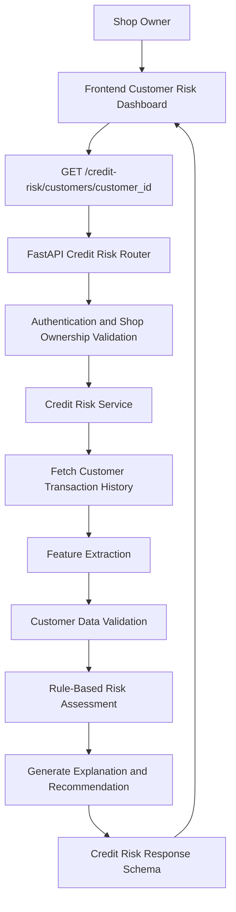

### Backend Implementation

**1. Credit Risk API**

File: `backend/app/api/credit_risk.py`

The module exposes the following endpoint:

| Method | Endpoint | Description |
|---|---|---|
| GET | `/credit-risk/customers/{customer_id}` | Analyze a customer's credit risk |

The endpoint uses the authenticated user dependency and passes the customer ID, current user, and database session to the credit risk service.

**2. Credit Risk Service**

File: `backend/app/services/credit_risk.py`

The main function is:

`analyze_customer_credit_risk()`

Its responsibilities include:

- Verifying that the customer belongs to the authenticated user's shop.
- Retrieving the customer's complete transaction history.
- Calling the feature extraction function.
- Passing calculated features to the risk assessment engine.
- Constructing the final structured response.

The service also prevents users from analyzing customers belonging to other shops.

**3. Feature Extraction**

File: `backend/app/ml/features.py`

The `extract_customer_features()` function processes transaction history and calculates financial indicators.

Features include:

| Feature | Description |
|---|---|
| `total_transactions` | Total number of transactions |
| `credit_count` | Number of credit transactions |
| `payment_count` | Number of payment transactions |
| `total_credit_amount` | Total credit amount |
| `total_payment_amount` | Total payment amount |
| `outstanding_balance` | Credit amount minus payment amount |
| `repayment_ratio` | Payment amount divided by credit amount |
| `average_credit_amount` | Average credit transaction value |
| `days_since_last_payment` | Days since the most recent payment |
| `days_since_last_transaction` | Days since the most recent transaction |

The repayment ratio is calculated as:

```python
repayment_ratio = total_payment / total_credit
```

If the total credit amount is zero, the repayment ratio is set to zero.

The feature extraction logic also handles transaction timestamps and converts timezone-naive timestamps to UTC before calculating elapsed time.

**4. Customer Data Validation**

File: `backend/app/ml/features.py`

The `validate_customer_data()` function checks whether sufficient transaction history is available.

Current minimum requirements:

- At least 5 total transactions.
- At least 2 payment transactions.

If these requirements are not satisfied, the assessment returns `insufficient_data`.

**5. Risk Assessment Engine**

File: `backend/app/ml/risk_assessment.py`

The `assess_customer_risk()` function uses transparent baseline rules based on the repayment ratio.

| Repayment Ratio | Risk Classification |
|---|---|
| 80% or higher | Low Risk |
| 50% to below 80% | Medium Risk |
| Below 50% | High Risk |

The engine also examines the outstanding balance and generates explanations.

For example:

- A repayment ratio of 80% or higher indicates a relatively strong repayment pattern.
- A repayment ratio between 50% and 80% indicates that repayment history should be reviewed.
- A repayment ratio below 50% indicates a higher credit risk.

The engine generates a recommendation for each risk category.

**Important implementation detail:** This version uses explainable rule-based logic rather than a trained classification model. The response currently returns `risk_score` as `None`. It is an initial lightweight risk assessment engine, not a trained predictive ML model.

### Risk Assessment Response

File: `backend/app/schemas/credit_risk.py`

The `CreditRiskResponse` schema returns:

- Customer ID
- Risk level
- Risk score
- Total transactions
- Total credit amount
- Total payment amount
- Outstanding balance
- Repayment ratio
- Explanation
- Recommendation

The risk level supports four values:

- `low`
- `medium`
- `high`
- `insufficient_data`

---

## Part B: FIFO-Based Repayment Allocation

### Problem Statement

Suppose a customer has taken goods on credit multiple times:

| Credit Transaction | Amount |
|---|---:|
| First Credit | ₹1,000 |
| Second Credit | ₹500 |
| Third Credit | ₹800 |
| **Total Credit** | **₹2,300** |

Now the customer makes a payment of ₹1,200.

Instead of manually deciding which credit record should be cleared, the system automatically allocates the payment to the oldest outstanding credit first.

### FIFO Principle

FIFO stands for **First In, First Out**.

Under this approach, the oldest outstanding credit transaction receives payment allocation first.

### FIFO Architecture Flow

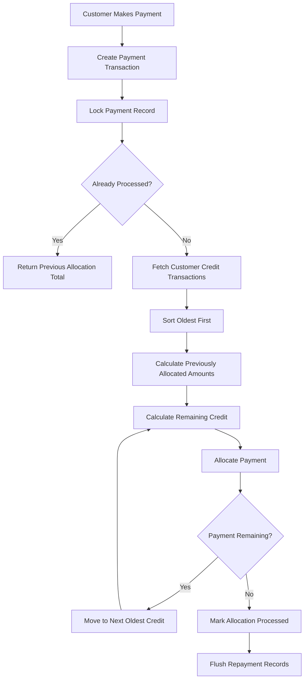

### Backend Implementation

**1. Repayment Allocation Service**

File: `backend/app/services/repayment.py`

The main function is:

`allocate_payment_to_credits()`

Its responsibilities include:

1. Verify that the supplied transaction is a payment.
2. Lock the payment transaction using `SELECT FOR UPDATE`.
3. Check whether allocation has already been processed.
4. Retrieve the customer's credit transactions in chronological order.
5. Calculate amounts already allocated to each credit.
6. Determine the remaining outstanding amount for each credit.
7. Allocate the payment to the oldest outstanding credit first.
8. Mark the payment as processed.
9. Flush the repayment records.

The service uses SQLAlchemy's `with_for_update()` to lock the payment and credit transaction rows during allocation.

### Example of FIFO Allocation

Assume the following transactions:

| Credit | Original Amount | Allocation |
|---|---:|---:|
| Credit 1 | ₹1,000 | ₹1,000 |
| Credit 2 | ₹500 | ₹200 |
| Credit 3 | ₹800 | ₹0 |

Payment received: ₹1,200.

Remaining payment: ₹0.

The first credit is completely cleared, and ₹200 is allocated to the second credit.

### 2. Repayment Database Model

File: `backend/app/models/repayment.py`

The `Repayment` model stores the relationship between credit transactions and payment transactions.

Important fields:

- `id`
- `credit_transaction_id`
- `payment_transaction_id`
- `amount`
- `allocated_at`

The model also defines:

- A unique constraint on the credit and payment transaction combination.
- A check constraint ensuring that the allocated amount is greater than zero.

This creates a traceable allocation record rather than simply modifying the original credit transaction.

### 3. Integration with Transaction Management

File: `backend/app/services/transaction.py`

The transaction creation service invokes `allocate_payment_to_credits()` whenever a payment transaction is created.

The repayment records are flushed as part of the surrounding transaction workflow and committed with the transaction and related records.

### Complete Integration Flow

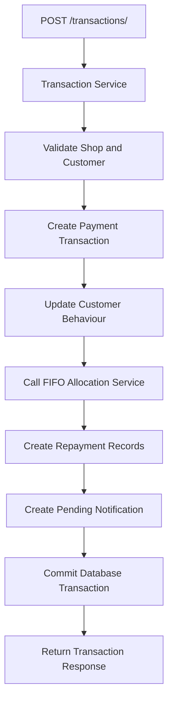

### Key Learning

This module demonstrates financial feature engineering, explainable rule-based risk assessment, SQLAlchemy row locking, FIFO allocation, relational repayment modelling, and transactional consistency.

---

# 10. AI-Powered Voice Transaction Entry

## Overview

The AI-Powered Voice Transaction Entry module allows shop owners to record customer credit and payment transactions using natural speech instead of manually filling out forms.

For example, a shop owner can say:

> "Krishna ne 500 rupaye ka saman udhar liya."

The system processes the recording, converts speech into text, extracts transaction details, identifies the customer, and prepares a transaction preview.

The transaction is saved only after the user confirms the extracted information.

## Architecture

The module follows a multi-stage processing architecture:

1. Audio capture
2. Audio upload
3. Speech-to-text conversion
4. Transaction information extraction
5. Customer identification
6. Preview generation
7. User confirmation
8. Transaction persistence

### Complete Architecture Flow

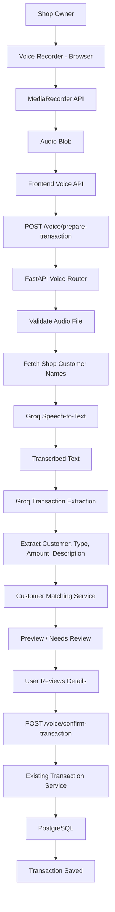

## Frontend Implementation

**1. Voice Recorder**

File: `frontend/src/features/voice/components/voice-recorder.tsx`

The `VoiceRecorder` component handles browser-based audio recording.

It uses:

- `navigator.mediaDevices.getUserMedia()` to access the microphone.
- `MediaRecorder` to record audio.
- `Blob` to combine recorded audio chunks.

The component checks supported audio formats, starts and stops recording, and releases microphone tracks after recording.

When recording is complete, the audio Blob is passed to the parent component through the `onAudioReady()` callback.

**2. Voice Transaction Assistant**

File: `frontend/src/features/voice/components/voice-transaction-assistant.tsx`

This component coordinates the complete voice transaction workflow.

Its responsibilities include:

- Receiving recorded audio.
- Calling the voice preparation API.
- Displaying transcription results.
- Showing extracted transaction information.
- Displaying customer matching results.
- Validating missing fields.
- Requiring confirmation before saving.
- Handling errors and successful transaction responses.

The assistant also checks that the matched customer is the same customer whose detail page is currently open.

**3. Voice API Integration**

File: `frontend/src/features/voice/voice-api.ts`

The API integration provides functions for:

- `transcribeVoice()`
- `prepareVoiceTransaction()`
- `confirmVoiceTransaction()`
- `prepareTextTransaction()`

The `createAudioFile()` helper converts the recorded Blob into a File with a supported audio extension.

Audio is sent using `FormData`, while transaction confirmation is sent as JSON.

## Backend Implementation

**1. Voice API Router**

File: `backend/app/api/voice.py`

The voice router exposes the following endpoints:

| Method | Endpoint | Purpose |
|---|---|---|
| POST | `/voice/transcribe` | Convert uploaded audio into text |
| POST | `/voice/prepare-transaction` | Process audio and prepare a transaction preview |
| POST | `/voice/prepare-text-transaction` | Extract transaction information from text |
| POST | `/voice/confirm-transaction` | Save a confirmed voice transaction |

The endpoints use authentication through `get_current_user`.

**2. Audio Validation**

File: `backend/app/api/voice.py`

Before processing, the backend validates:

- Audio content type.
- Whether the uploaded audio is empty.
- Maximum audio file size.

The current maximum audio size is 25 MB.

Supported formats include WebM, WAV, MP3, MPEG, MP4, and OGG.

**3. Speech-to-Text Service**

File: `backend/app/services/speech_to_text.py`

The `transcribe_audio()` function integrates with Groq's audio transcription API.

It uses the configured `GROQ_STT_MODEL`.

The transcription prompt contains Indian shopkeeper vocabulary, including:

- Udhar
- Jama
- Bhugtan
- Diye
- Liye
- Credit
- Payment
- Baki
- Rupaye

The prompt instructs the transcription system to preserve the original spoken language, names, and amounts instead of translating the speech.

The system can also receive known customer names as additional transcription context.

**4. Transaction Extraction Service**

File: `backend/app/services/voice_extraction.py`

After speech-to-text conversion, the transcribed text is passed to `extract_transaction_details()`.

This function integrates with Groq's chat completion API using the configured `GROQ_CHAT_MODEL`.

The extraction prompt instructs the model to identify:

- Customer name
- Transaction type
- Amount
- Description
- Due date

The response uses a strict JSON schema.

The model is instructed not to invent missing financial details and to return null for information that cannot be identified reliably.

**5. Voice Schemas**

File: `backend/app/schemas/voice.py`

The schema defines the data structures used throughout voice processing:

- `TextTransactionRequest`
- `VoiceTransactionExtraction`
- `MatchedCustomerResponse`
- `CustomerMatchResponse`
- `VoiceTransactionConfirm`

Pydantic validates the extracted and confirmed transaction data before it reaches the transaction service.

## Preview and Confirmation Architecture

The system does not immediately save a transaction after AI extraction.

Instead, it returns one of two processing states:

**`preview_ready`**

Returned when the required transaction details are available and the customer has one unique match.

**`needs_review`**

Returned when required information is missing or the customer cannot be uniquely matched.

The user must review the details before confirming the transaction.

### Confirmation Flow

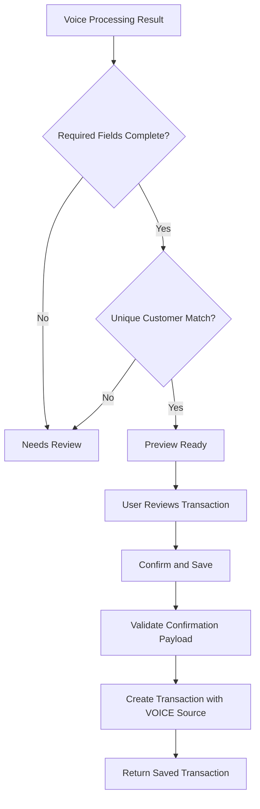

During confirmation, the backend reuses the existing `create_transaction()` service.

It sets the transaction source to `VOICE`, ensuring that voice-created transactions can be distinguished from manually entered transactions.

### Key Learning

This module demonstrates browser audio recording, asynchronous API integration, speech-to-text processing, LLM-based structured information extraction, Pydantic validation, customer matching, and human-in-the-loop transaction confirmation.

---

# 11. Multilingual AI Voice Transaction Processing

## Overview

Small shop owners may naturally communicate in Hindi, Marathi, English, Hinglish, or a mixture of these languages.

A voice transaction system designed only for English would create unnecessary barriers for many Indian shopkeepers.

To address this, Universal Digital Khata includes multilingual speech transcription and transaction extraction capabilities.

The system is designed to understand common local business expressions and extract structured financial information from natural conversations.

## Supported Languages

The current prompts explicitly support:

- Hindi
- Marathi
- English
- Hinglish
- Mixed Hindi-English
- Mixed Marathi-English

## Multilingual Processing Architecture

The multilingual pipeline uses two AI processing stages:

1. Speech-to-text transcription using Groq.
2. Structured transaction extraction using Groq's chat completion API.

### Architecture Flow

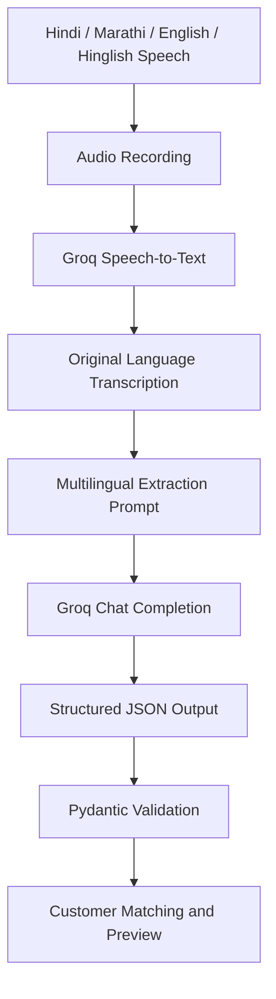

## Implementation Details

**1. Multilingual Speech Recognition Prompt**

File: `backend/app/services/speech_to_text.py`

The `BASE_TRANSCRIPTION_PROMPT` contains instructions for recognizing common Indian shopkeeper terminology.

The transcription service is instructed to:

- Preserve the original spoken language.
- Avoid unnecessary translation.
- Preserve customer names.
- Preserve numerical amounts.
- Recognize common transaction-related vocabulary.

The `build_transcription_prompt()` function dynamically adds known customer names to the transcription prompt.

It removes duplicate names and limits the additional customer-name context to 30 names.

The final prompt is limited to 896 characters, matching the configured Whisper prompt constraint documented in the implementation.

**2. Multilingual Transaction Extraction**

File: `backend/app/services/voice_extraction.py`

The extraction service contains a detailed system prompt describing how to interpret Hindi, Marathi, English, Hinglish, and mixed-language expressions.

An important responsibility is distinguishing between credit and completed payment.

### Credit Classification

A transaction is classified as credit when the customer receives goods or services but has not paid yet.

Examples:

| Spoken Expression | Classification |
|---|---|
| Krishna ne 500 rupaye udhar liye | Credit |
| Rahul kal paise dega | Credit |
| Payment baad mein karega | Credit |
| Paise dena baaki hai | Credit |

### Payment Classification

A transaction is classified as payment only when money has actually been received.

Examples:

| Spoken Expression | Classification |
|---|---|
| Krishna ne 400 rupaye de diye | Payment |
| Rahul se 500 rupaye mile | Payment |
| Paise jama kiye | Payment |
| Customer ne payment kar diya | Payment |

If the spoken sentence does not clearly establish whether payment has been completed, the extraction prompt instructs the model to return `null` for the transaction type.

This distinction is important because incorrectly classifying a credit transaction as a payment could produce incorrect financial records.

**3. Customer Name Extraction**

The extraction prompt includes instructions for handling Indian names and common conversational honorifics.

For example:

- Krishna Bhaiya → Krishna
- Rahul Sharma Ji → Rahul Sharma
- Krishna Burande → Krishna Burande

The system is instructed to preserve actual names and surnames, remove conversational honorifics when appropriate, and avoid inventing customer identities.

**4. Amount Extraction**

The extraction prompt supports Hindi and Marathi number expressions.

Examples:

| Spoken Number | Extracted Value |
|---|---:|
| सौ | 100 |
| दो सौ | 200 |
| पांच सौ | 500 |
| पाचशे | 500 |
| हजार | 1,000 |
| दोन हजार | 2,000 |

It also supports common currency expressions such as Rs, INR, rupees, and रुपये.

**5. Strict Structured JSON Output**

File: `backend/app/services/voice_extraction.py`

The extraction service defines `TRANSACTION_EXTRACTION_SCHEMA`.

The model must return the following fields:

```json
{
  "customer_name": "Krishna",
  "transaction_type": "credit",
  "amount": 500,
  "description": "Grocery items",
  "due_date": null
}
```

This is an illustrative example of the expected response structure.

The actual implementation uses strict JSON schema output with `additionalProperties` disabled.

The result is parsed using Python's JSON module and validated using `VoiceTransactionExtraction`.

**6. Due Date Extraction**

The extraction prompt supports explicit date expressions such as:

- Tomorrow
- Next Monday
- Kal
- उद्या
- पुढच्या आठवड्यात

It instructs the model not to invent dates and to return null when the date is unclear.

### Key Learning

This module demonstrates multilingual prompt engineering, domain-specific vocabulary, contextual language understanding, strict JSON schema generation, and financial intent classification.

---

# 12. Improved Multilingual Voice Extraction & Intelligent Customer Matching

## Overview

The initial voice transaction pipeline required reliable customer name extraction and accurate identification of the corresponding customer record.

Real-world speech can contain:

- Different pronunciations.
- Incomplete names.
- First names instead of full names.
- Initials.
- Minor speech recognition errors.
- Honorifics and conversational expressions.

To improve reliability, the application includes a dedicated customer matching service.

Instead of depending only on exact name matching, the system uses normalization, token-based comparison, partial matching, and conservative fuzzy matching.

The module also ensures that ambiguous customer matches are never automatically selected.

## Architecture

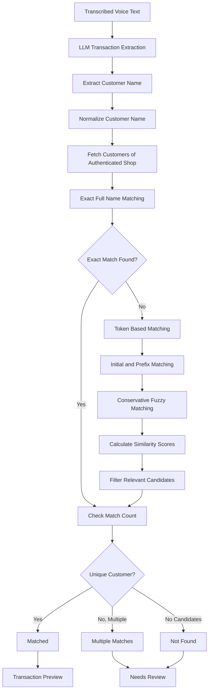

## Backend Implementation

**1. Customer Matching Service**

File: `backend/app/services/customer_matching.py`

The main function is:

`match_customer()`

It identifies the best customer candidates from the authenticated user's shop.

The service first retrieves the shop belonging to the logged-in user and then fetches customers associated with that shop.

It never searches customers outside the current shop.

**2. Customer Name Normalization**

Function: `normalize_name()`

The service normalizes names before comparison.

It performs:

- Case-insensitive conversion using `casefold()`.
- Leading and trailing whitespace removal.
- Punctuation normalization.
- Removal of unnecessary repeated spaces.

For example:

```text
" KRISHNA  BURANDE "
"Krishna Burande"
"krishna burande"
```

These values are normalized into a comparable representation.

**3. Exact Full-Name Matching**

The service first attempts exact normalized full-name matching.

If exactly one customer matches, the result is:

`matched`

If multiple customers match the same normalized name, the result is:

`multiple_matches`

This priority prevents approximate matching from overriding a reliable exact match.

**4. Token-Based Matching**

Function: `match_name_tokens()`

If exact matching fails, the service compares individual name tokens.

The implementation supports:

| Matching Strategy | Example |
|---|---|
| Exact token | Krishna → Krishna |
| Initial matching | Krishna B → Krishna Burande |
| Partial prefix matching | Krish → Krishna |
| Conservative fuzzy matching | Small spelling variation |

The matching implementation uses `SequenceMatcher` from Python's `difflib` library for spelling similarity.

The current matching thresholds are:

- Exact token match: `1.00`
- Initial match: `0.90`
- Partial prefix match: `0.95`
- Fuzzy match: at least `0.85`

The final candidate score is calculated from the average token match score.

**5. Candidate Selection**

After calculating similarity scores, the service sorts candidates from highest to lowest score.

It considers candidates with:

- A score of at least `0.85`.
- A score no more than `0.15` below the best candidate.

If multiple relevant candidates remain, the service returns `multiple_matches` instead of guessing.

The response contains up to 10 matching customer candidates.

If exactly one relevant candidate remains, the result is `matched`.

If no suitable candidate exists, the result is `not_found`.

## Customer Matching Response

File: `backend/app/schemas/voice.py`

The `CustomerMatchResponse` schema defines three possible statuses:

| Status | Meaning |
|---|---|
| `matched` | Exactly one customer has been identified |
| `multiple_matches` | Multiple possible customers exist |
| `not_found` | No suitable customer was identified |

The response includes matching customer IDs, names, and available mobile numbers.

## Integration with Voice Transaction Processing

File: `backend/app/api/voice.py`

The voice preparation endpoint calls the customer matching service after extracting the customer name.

An important implementation decision is that customer matching is still attempted when the customer name is available, even if the amount or transaction type is missing.

This allows the preview to show customer matching results while separately identifying missing transaction information.

The API returns:

- `preview_ready` when required transaction details are complete and there is one unique customer match.
- `needs_review` when transaction information is incomplete or customer matching is ambiguous.

## Frontend Integration and Safety

File: `frontend/src/features/voice/components/voice-transaction-assistant.tsx`

The frontend displays the extracted transaction information and customer matching results.

Before allowing confirmation, it checks:

1. A unique customer must be matched.
2. The matched customer ID must match the currently opened customer page.
3. Transaction type must be available.
4. Amount must be numeric and greater than zero.
5. No required fields should be missing.
6. A payment transaction must not contain a due date.

If these conditions are not satisfied, the transaction cannot be confirmed.

This adds an important human verification step before financial data is saved.

## Confirmation and Duplicate Protection

The frontend creates a UUID confirmation ID using `crypto.randomUUID()`.

It reuses the same confirmation ID if the confirmation request needs to be retried.

File: `backend/app/api/voice.py`

The `/voice/confirm-transaction` endpoint converts the confirmed payload into `VoiceTransactionCreate` and calls the existing transaction service.

The transaction is saved with:

- `TransactionSource.VOICE`
- The supplied confirmation ID as the idempotency key.

File: `backend/app/services/transaction.py`

The existing idempotency logic prevents the same confirmation request from creating duplicate transactions.

### Complete Voice-to-Database Architecture

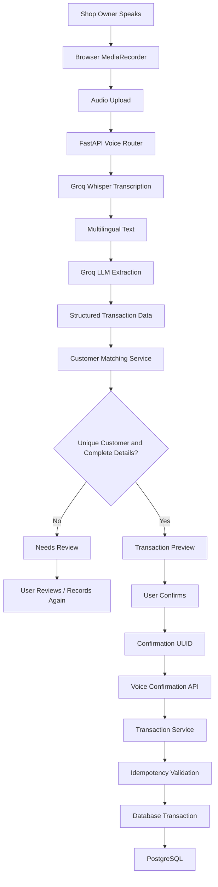

### Key Learning

This module demonstrates intelligent entity matching, text normalization, token-based similarity, fuzzy string matching, ambiguity handling, authenticated data isolation, human-in-the-loop validation, and idempotent financial transaction confirmation.

---

# Batch 3 – Modules Covered

| Module | Feature | Main Technologies |
|---|---|---|
| 9 | Credit Risk Assessment & FIFO Repayment | Python, SQLAlchemy, Decimal, Rule-Based Logic |
| 10 | AI Voice Transaction Entry | MediaRecorder, FastAPI, Groq |
| 11 | Multilingual Voice Processing | Groq Whisper, LLM, JSON Schema |
| 12 | Intelligent Customer Matching | Python, SequenceMatcher, Pydantic |

## Overall Architecture: Modules 9–12

The following diagram shows how these four capabilities connect with the existing core application.

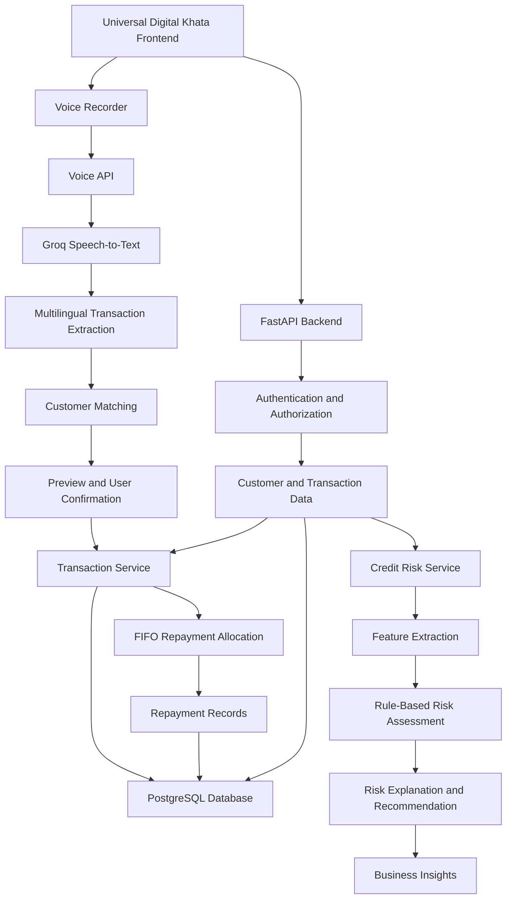

## Important Architecture Decisions

1. **Separation of concerns:** API routers, business services, ML utilities, schemas, and database models have separate responsibilities.
2. **Authenticated data isolation:** Customer and risk-related operations verify shop ownership.
3. **Human-in-the-loop AI:** Extracted voice transactions are reviewed before persistence.
4. **Financial consistency:** Decimal values are used for monetary calculations, and transaction changes are committed through database transactions.
5. **Duplicate protection:** Idempotency keys protect transaction confirmation against repeated requests.
6. **Lightweight processing:** The current risk assessment uses Python-based rules and calculated features rather than loading a large trained model.
7. **Reusable business logic:** Voice transactions reuse the same transaction service as manual transactions.

# 13. Customer Credit Risk Dashboard

## Overview

The Customer Credit Risk Dashboard provides shop owners with a visual representation of customer repayment behaviour and credit risk assessments.

Instead of displaying only outstanding balances, the dashboard combines financial indicators, repayment ratios, risk classifications, explanations, and recommendations.

It helps shop owners understand which customers have relatively strong repayment patterns and which customers may require additional attention before extending more credit.

## Architecture

The dashboard follows a frontend-to-backend data flow.

The frontend requests a customer's credit risk assessment, the backend analyzes the customer's transaction history, and the resulting structured assessment is displayed through a dedicated React component.

### Architecture Flow

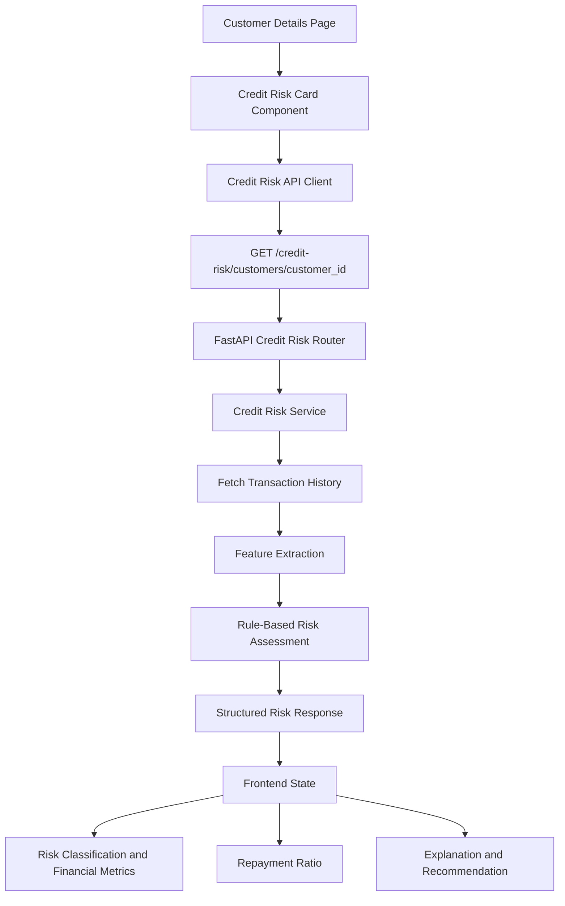

## Frontend Implementation

### 1. Credit Risk API Integration

File: `frontend/src/features/credit-risk/credit-risk-api.ts`

The `getCustomerCreditRisk()` function sends an authenticated GET request to:

`/credit-risk/customers/{customerId}`

It receives the backend response using the `CreditRiskResponse` TypeScript interface.

### 2. Credit Risk Response Types

File: `frontend/src/features/credit-risk/types.ts`

The interface defines the data required by the dashboard:

- Customer ID
- Risk level
- Risk score
- Total transactions
- Total credit amount
- Total payment amount
- Outstanding balance
- Repayment ratio
- Explanation
- Recommendation

The frontend supports four risk states:

| Risk Level | Dashboard Label |
|---|---|
| `low` | Low Risk |
| `medium` | Medium Risk |
| `high` | High Risk |
| `insufficient_data` | Insufficient Data |

### 3. Credit Risk Card Component

File: `frontend/src/features/credit-risk/components/credit-risk-card.tsx`

The `CreditRiskCard` component is responsible for displaying the complete assessment.

Its responsibilities include:

- Fetching the credit risk assessment.
- Managing loading and error states.
- Providing a retry option.
- Displaying risk classification.
- Formatting financial values using INR currency formatting.
- Displaying total transactions and financial amounts.
- Visualizing the repayment ratio.
- Showing assessment explanations.
- Displaying recommendations.

The component accepts two props:

- `customerId`: Identifies the customer being analyzed.
- `refreshKey`: Allows the assessment to be refreshed when relevant customer data changes.

The component uses React's `useEffect`, `useCallback`, and `useState` hooks for API execution and state management.

### 4. Repayment Ratio Visualization

The repayment ratio is converted into a percentage:

```typescript
const repaymentPercentage =
  assessment.repayment_ratio * 100;
```

The component displays this value using a progress bar.

The visual width is constrained between 0% and 100% to avoid invalid CSS widths.

The dashboard also displays the explanation:

"Total payments divided by total credit."

### 5. Risk Explanation and Recommendation

The dashboard displays the explanation returned by the backend instead of showing only a risk label.

For example, the assessment may explain that the repayment ratio is below 50% and that an outstanding balance remains.

It also displays a recommendation based on the calculated risk category.

An important design decision is that the dashboard explicitly identifies the assessment as rule-based decision support rather than a trained predictive ML model.

## Backend Integration

The backend assessment logic is reused from Module 9.

Important files:

- `backend/app/api/credit_risk.py`
- `backend/app/services/credit_risk.py`
- `backend/app/ml/features.py`
- `backend/app/ml/risk_assessment.py`
- `backend/app/schemas/credit_risk.py`

The frontend does not independently calculate risk. It consumes the structured response generated by the backend.

## Complete Data Flow

1. The shop owner opens a customer's details.
2. The Credit Risk Card component loads.
3. The frontend calls the credit risk API.
4. The backend verifies customer ownership.
5. Transaction history is retrieved.
6. Financial features are calculated.
7. The risk assessment engine generates the classification.
8. The backend returns explanations and recommendations.
9. The frontend displays the assessment.

### Key Learning

This module demonstrates API-driven dashboard development, reusable React components, asynchronous state management, financial data visualization, INR formatting, and explainable risk presentation.

---

# 14. Customer Notifications & Payment Reminders

## Overview

The Customer Notifications module maintains a record of important customer-related financial events.

Whenever a credit or payment transaction is created, the transaction service generates a corresponding notification record.

The system also includes a payment reminder generator that identifies outstanding credit transactions whose due dates have arrived.

This module helps shop owners keep track of credit additions, received payments, balance-related events, and payment reminders.

## Notification Types

The database model supports four notification types:

| Notification Type | Purpose |
|---|---|
| `credit_added` | A new credit transaction has been recorded |
| `payment_received` | A customer payment has been recorded |
| `balance_updated` | Represents a balance-related notification type |
| `payment_reminder` | A due or overdue payment reminder |

The notification model also supports three delivery statuses:

- `pending`
- `sent`
- `failed`

## Architecture

The notification functionality has two main workflows:

1. Transaction-triggered notification creation.
2. Scheduled or manually executed payment reminder generation.

### Part A: Transaction-Triggered Notification Flow

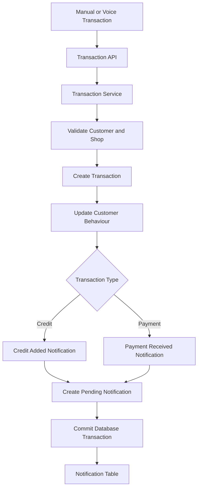

### 1. Notification Creation

File: `backend/app/services/transaction.py`

The `create_transaction()` service handles notification creation as part of the transaction workflow.

For credit transactions, it creates a notification with type:

`NotificationType.CREDIT_ADDED`

For payment transactions, it creates a notification with type:

`NotificationType.PAYMENT_RECEIVED`

The notification message includes the transaction amount.

The notification is initially stored with:

`NotificationStatus.PENDING`

The transaction, customer behaviour update, repayment allocation where applicable, and notification are committed through the same database transaction.

### Part B: Payment Reminder Generation

## Problem Statement

Suppose a customer has taken ₹1,000 worth of goods on credit and the due date has passed.

The shop owner needs to identify that the payment is overdue and understand how much remains outstanding.

The reminder service calculates the remaining amount using the original credit amount and repayment allocations.

### Reminder Architecture Flow

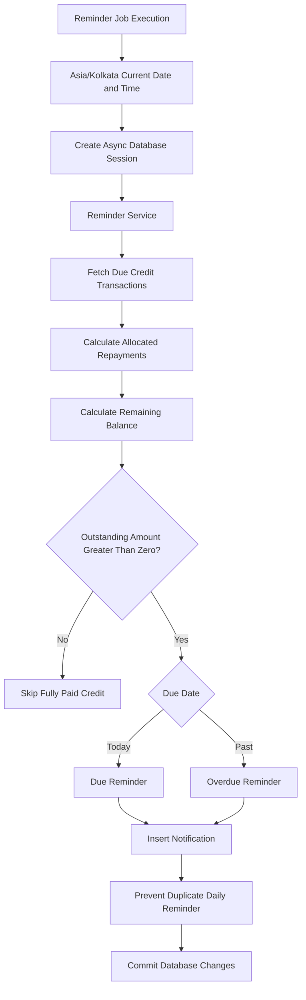

### 2. Reminder Generation Service

File: `backend/app/services/reminder.py`

The main function is:

`generate_payment_reminders()`

It accepts:

- An asynchronous SQLAlchemy database session.
- A timezone-aware `as_of` datetime.

Its responsibilities include:

1. Finding credit transactions with non-null due dates.
2. Selecting transactions whose due dates have arrived.
3. Calculating previously allocated repayment amounts.
4. Calculating the remaining outstanding amount.
5. Skipping fully paid credit transactions.
6. Determining whether a payment is due or overdue.
7. Creating a payment reminder notification.
8. Preventing duplicate reminders for the same credit transaction on the same calendar day.
9. Committing the generated notification records.

### 3. Outstanding Amount Calculation

The reminder service calculates the remaining amount as:

```python
remaining_amount = (
    Decimal(str(credit.amount))
    - Decimal(str(allocated_amount))
)
```

This ensures that customers are not reminded about amounts that have already been fully allocated through repayments.

### 4. Due and Overdue Classification

The service converts the credit due date into the reminder job's timezone.

It then compares the due date with the current date:

- If the due date is earlier than the current date, the reminder is marked as overdue.
- Otherwise, the reminder is marked as due.

The reminder message includes the remaining outstanding amount and due date.

### 5. Duplicate Reminder Prevention

The reminder service uses PostgreSQL's `INSERT ... ON CONFLICT DO NOTHING`.

The uniqueness condition is based on:

- `transaction_id`
- `reminder_date`

It applies specifically to payment reminder notifications.

This prevents the same credit transaction from generating duplicate reminders on the same calendar day.

## Reminder Job Execution

File: `backend/app/jobs/generate_reminders.py`

The job:

1. Uses the `Asia/Kolkata` timezone.
2. Generates the current timezone-aware datetime.
3. Opens an asynchronous database session.
4. Calls `generate_payment_reminders()`.
5. Prints the execution date and number of newly created reminders.

It can be executed as a Python module or script from the configured backend environment.

**Implementation note:** The repository contains the reminder job script and reminder-generation service. The script itself does not configure a recurring scheduler. A cron service or external scheduler would be needed to execute it automatically at a fixed interval.

## Notification Database Model

File: `backend/app/models/notification.py`

The `Notification` model stores:

- `id`
- `customer_id`
- `transaction_id`
- `notification_type`
- `reminder_date`
- `message`
- `status`
- `sent_at`
- `created_at`

The model includes database constraints to ensure that payment reminders have the required transaction and reminder date fields.

It also defines a PostgreSQL partial unique index for daily reminder duplicate prevention.

## Backend Notification APIs

File: `backend/app/api/notification.py`

The notification router exposes:

| Method | Endpoint | Purpose |
|---|---|---|
| GET | `/notifications/` | Retrieve shop notifications |
| GET | `/notifications/customers/{customer_id}` | Retrieve notifications for one customer |

Both endpoints require authentication.

The customer-specific endpoint verifies that the customer belongs to the authenticated user's shop.

Both endpoints support pagination using `skip` and `limit`.

The maximum page size is 100.

## Frontend Implementation

### 1. Notification API

File: `frontend/src/features/notifications/notification-api.ts`

The `getNotifications()` function retrieves shop notifications from:

`/notifications/`

It supports pagination parameters and uses the authenticated API client.

### 2. Notification Types

File: `frontend/src/features/notifications/types.ts`

The frontend defines TypeScript types for:

- Notification type.
- Notification status.
- Notification response.
- Pagination parameters.

These types keep frontend notification handling consistent with the backend response structure.

### 3. Notification List Component

File: `frontend/src/features/notifications/components/notification-list.tsx`

The `NotificationList` component displays notifications in a structured list.

It provides:

- Notification type labels.
- Type-specific visual styles.
- Formatted date and time.
- Notification messages.
- Delivery status.
- An empty state when no notifications are available.

Dates are formatted using the `en-IN` locale.

### 4. Notifications Page

File: `frontend/src/app/notifications/page.tsx`

The notifications page:

- Checks authentication.
- Redirects unauthenticated users to the login page.
- Fetches the latest 50 notifications.
- Displays the total notification count.
- Supports category filtering.
- Displays loading and error states.

The available filters are:

- All
- Credits
- Payments
- Reminders

The frontend filters the already-fetched notifications using React state and `useMemo()`.

## Important Implementation Distinction

The current notification implementation creates and displays notification records and tracks their delivery status.

The repository code documented here does not establish an external SMS, WhatsApp, email, or push-notification delivery provider. Therefore, `pending` should be understood as a stored notification state, not proof that a customer has received a message.

### Key Learning

This module demonstrates event-driven notification creation, background job design, asynchronous database processing, SQL aggregation, timezone-aware date handling, PostgreSQL conflict handling, and notification dashboard development.

---

# 15. Improved Multilingual Voice Transaction Processing

## Overview

This module improves the reliability of the voice transaction processing pipeline.

A voice-based financial application must correctly understand more than individual words. It must understand the shopkeeper's intended transaction, distinguish credit from completed payment, preserve customer names, and avoid inventing missing financial details.

The implementation improves the interaction between speech transcription, customer-name context, LLM-based extraction, customer matching, and transaction preview generation.

## Architecture

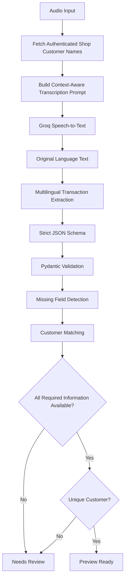

## Improvements in the Processing Pipeline

### 1. Customer-Aware Speech Transcription

File: `backend/app/services/speech_to_text.py`

The transcription service supports an optional list of known customer names.

The `build_transcription_prompt()` function combines:

- Indian shopkeeper transaction vocabulary.
- Hindi, Marathi, English, and Hinglish context.
- Known customer names from the authenticated shop.

It removes duplicate names and adds up to 30 unique customer names to the prompt.

This provides additional context to the speech recognition system when recognizing customer names.

### 2. Contextual Transaction Extraction

File: `backend/app/services/voice_extraction.py`

The extraction prompt contains detailed instructions for understanding the complete transaction sentence.

It covers:

- Credit versus completed payment classification.
- Customer name extraction.
- Honorific removal.
- Full-name and surname preservation.
- Hindi and Marathi number expressions.
- Transaction description extraction.
- Due date extraction.
- Missing and ambiguous information.

The implementation also instructs the model to distinguish between a future promise and a completed payment.

For example:

| Input | Expected Interpretation |
|---|---|
| Krishna will pay tomorrow | Credit |
| Krishna has paid ₹500 | Payment |
| Krishna bought goods but payment is unclear | Transaction type unknown |
| ₹400 received | Payment, customer name unknown |

This reduces the risk of creating incorrect financial records from ambiguous speech.

### 3. Strict Structured Output

The extraction service uses a JSON schema with strict response formatting.

The expected fields are:

```json
{
  "customer_name": "string or null",
  "transaction_type": "credit or payment or null",
  "amount": 0,
  "description": "string or null",
  "due_date": "ISO 8601 datetime or null"
}
```

The backend parses the returned JSON and validates it using:

`VoiceTransactionExtraction`

File: `backend/app/schemas/voice.py`

Important validations include:

- Transaction type must be credit or payment.
- Amount must be greater than zero when provided.
- Amount supports up to 12 digits and 2 decimal places.
- Description has a maximum length of 500 characters.
- Extra fields are rejected.

### 4. Improved Missing Information Handling

File: `backend/app/api/voice.py`

The `/voice/prepare-transaction` endpoint identifies missing fields independently.

It checks:

- Customer name.
- Amount.
- Transaction type.

If a customer name exists, customer matching is attempted even if amount or transaction type is missing.

This is useful because the system can still identify the customer while asking the shop owner to review incomplete financial information.

### 5. Safer Preview Generation

The endpoint returns:

`preview_ready`

only when the transaction information is complete and the customer is uniquely matched.

Otherwise, it returns:

`needs_review`

The system does not directly save the extracted AI response.

The user must review and confirm the transaction through the separate confirmation endpoint.

### 6. Text-Based Transaction Preparation

The same extraction pipeline also supports text input through:

`POST /voice/prepare-text-transaction`

Instead of recording audio, the frontend can send a natural-language message.

The backend passes the message directly to the transaction extraction service and then performs customer matching.

This allows the application to support both voice-based and text-based natural-language transaction entry.

## Main Files

| File | Responsibility |
|---|---|
| `backend/app/api/voice.py` | Voice and text processing endpoints |
| `backend/app/services/speech_to_text.py` | Speech transcription |
| `backend/app/services/voice_extraction.py` | Transaction detail extraction |
| `backend/app/services/customer_matching.py` | Customer identification |
| `backend/app/schemas/voice.py` | Structured validation |
| `frontend/src/features/voice/voice-api.ts` | Frontend API integration |
| `frontend/src/features/voice/types.ts` | Voice response types |
| `frontend/src/features/voice/components/voice-transaction-assistant.tsx` | Preview and confirmation UI |

### Key Learning

This module demonstrates contextual prompt engineering, multilingual financial intent extraction, schema-constrained LLM output, data validation, ambiguity handling, and human-reviewed AI workflows.

---

# 16. Transaction Idempotency & Customer Validation

## Overview

Financial applications must handle duplicate requests and invalid customer references carefully.

For example, a user may click the Save button twice, or a network timeout may occur after the backend has already saved a transaction.

If the frontend retries the request without duplicate protection, the same financial transaction could be recorded multiple times.

To address this problem, Universal Digital Khata implements backend idempotency validation and customer ownership checks.

The voice transaction confirmation flow also uses a confirmation UUID to protect against repeated confirmation requests.

## Part A: Transaction Idempotency

### What Is Idempotency?

Idempotency means that repeating the same request with the same unique key and identical transaction details should not create another transaction.

For example:

- First request: ₹500 credit transaction with key `K1`.
- Second request: Same ₹500 credit transaction with key `K1`.

Expected result: The existing transaction is returned instead of creating a duplicate.

However, if the same key is reused with different transaction details, the backend rejects the request.

### Architecture Flow

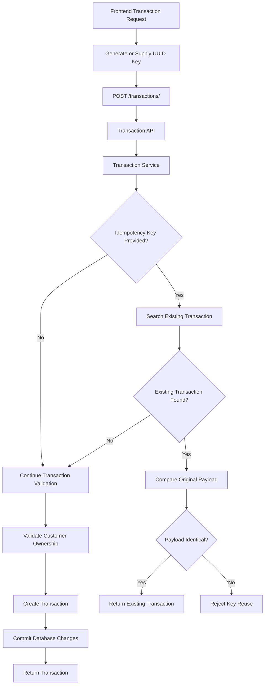

### 1. Frontend Idempotency Utility

File: `frontend/src/lib/idempotency.ts`

The utility exposes:

`generateIdempotencyKey()`

It generates a unique UUID using:

```typescript
export function generateIdempotencyKey(): string {
  return crypto.randomUUID();
}
```

This utility provides a reusable way to generate request identifiers.

### 2. Backend API Support

File: `backend/app/api/transaction.py`

The transaction creation endpoint accepts an optional HTTP header:

`Idempotency-Key`

FastAPI validates the value as a UUID before passing it to the transaction service.

The key is optional for the general transaction API.

### 3. Transaction Database Model

File: `backend/app/models/transaction.py`

The `Transaction` model includes:

```python
idempotency_key: Mapped[uuid.UUID | None] = mapped_column(
    UUID(as_uuid=True),
    unique=True,
    nullable=True
)
```

The unique database constraint prevents multiple transactions from storing the same non-null idempotency key.

### 4. Payload Validation

File: `backend/app/services/transaction.py`

The function:

`validate_idempotent_payload()`

compares the existing transaction with the incoming request.

It checks:

- Customer ID.
- Transaction type.
- Amount.
- Description.
- Due date.
- Transaction source.

If any of these values differ, the service raises a `ValueError`.

This prevents the same idempotency key from being reused for a different transaction.

### 5. Duplicate Request Handling

The `create_transaction()` function first checks whether the supplied key already exists within the authenticated user's shop.

If a matching transaction exists:

- The payload is validated.
- If identical, the existing transaction is returned.
- If different, the request is rejected.

The service also handles database `IntegrityError` exceptions.

This covers concurrent duplicate confirmation requests where two requests attempt to insert the same unique key at nearly the same time.

After rolling back the failed insert, the service checks whether the transaction was created by the competing request.

If found, it validates the payload and returns the existing transaction.

## Part B: Customer Ownership Validation

### Problem Statement

Every shop must access only its own customer records.

A user must not be able to create a transaction using a customer ID belonging to another shop.

### Customer Validation Architecture

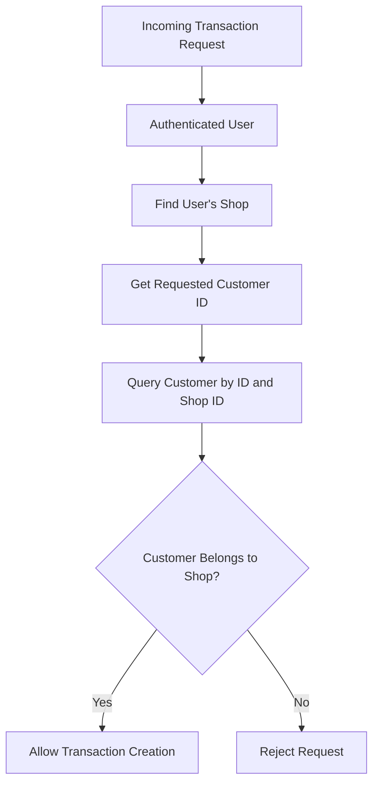

### Implementation

File: `backend/app/services/transaction.py`

The transaction service retrieves the authenticated user's shop and validates the customer using both:

- `Customer.id`
- `Customer.shop_id`

The service does not rely on the customer ID alone.

If the customer is not found inside the current shop, it raises:

`Customer not found in your shop`

This protects the application's shop-level data isolation.

## Part C: Voice Confirmation Idempotency

The voice transaction workflow also uses idempotency.

### Frontend Implementation

File: `frontend/src/features/voice/components/voice-transaction-assistant.tsx`

Before confirming a voice transaction, the frontend generates a confirmation UUID.

The component stores the confirmation ID in React state.

If the request needs to be retried, the same confirmation ID is reused rather than generating a new one.

### Backend Implementation

File: `backend/app/api/voice.py`

The `/voice/confirm-transaction` endpoint receives the confirmation payload and calls the shared transaction service.

It passes:

- Transaction source: `TransactionSource.VOICE`
- Idempotency key: `payload.confirmation_id`

The existing transaction service then performs duplicate detection and payload validation.

### Complete Voice Confirmation Flow

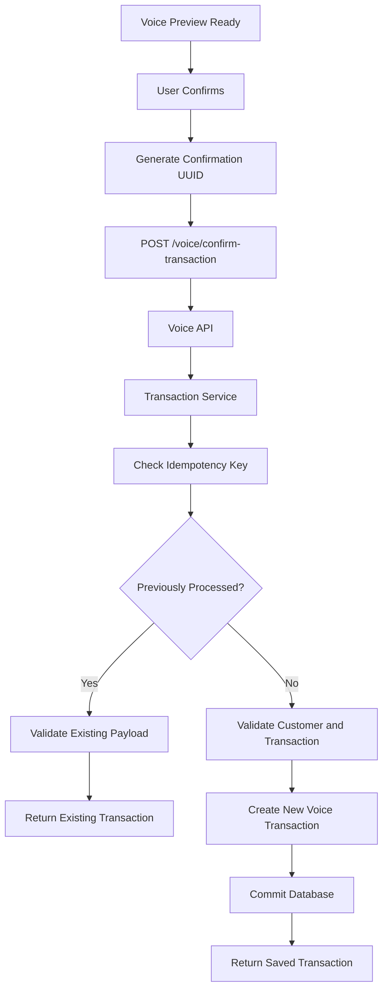

## Important Implementation Note

The backend supports optional idempotency keys for manual transaction creation, and the voice confirmation frontend actively reuses a confirmation UUID.

The current manual transaction form at:

`frontend/src/features/transactions/components/transaction-form.tsx`

calls `createTransaction()` without passing an idempotency key.

Therefore, the backend capability and reusable UUID utility are present, but the current manual form does not yet actively use that protection.

## Complete Module File References

| File | Responsibility |
|---|---|
| `frontend/src/lib/idempotency.ts` | UUID generation utility |
| `frontend/src/features/transactions/transaction-api.ts` | Transaction API client |
| `frontend/src/features/transactions/components/transaction-form.tsx` | Manual transaction form |
| `backend/app/api/transaction.py` | Idempotency header handling |
| `backend/app/services/transaction.py` | Duplicate detection and payload comparison |
| `backend/app/models/transaction.py` | Unique idempotency key storage |
| `backend/app/api/voice.py` | Voice confirmation integration |
| `frontend/src/features/voice/components/voice-transaction-assistant.tsx` | Confirmation UUID management |

### Key Learning

This module demonstrates idempotent API design, UUID-based request identification, database uniqueness constraints, race-condition handling, payload validation, authenticated shop-level data isolation, and safe financial transaction processing.

---

# Batch 4 – Modules Covered

| Module | Feature | Main Technologies |
|---|---|---|
| 13 | Customer Credit Risk Dashboard | Next.js, React, TypeScript |
| 14 | Notifications & Payment Reminders | FastAPI, SQLAlchemy, PostgreSQL |
| 15 | Improved Multilingual Voice Processing | Groq, LLM, Pydantic |
| 16 | Transaction Idempotency & Customer Validation | FastAPI, UUID, SQLAlchemy |

## Combined Architecture – Modules 13–16

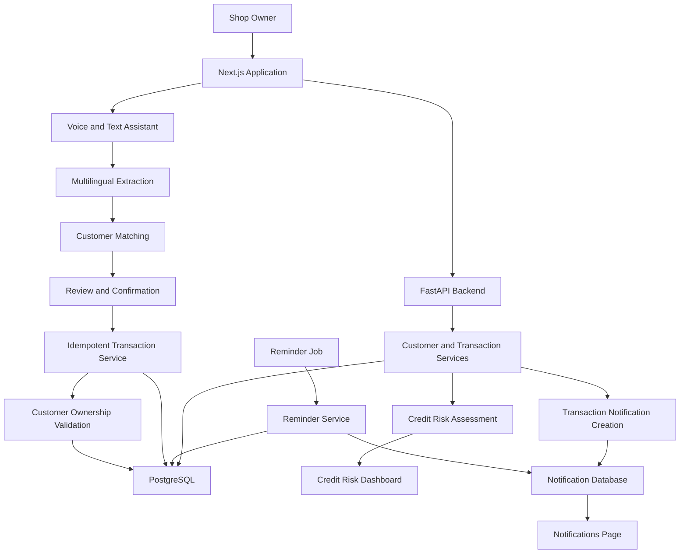

## Important Engineering Concepts Demonstrated

1. Reusable frontend components and API clients.
2. Explainable financial dashboards.
3. Transaction-triggered notification creation.
4. Timezone-aware reminder generation.
5. PostgreSQL partial unique indexes and conflict handling.
6. Multilingual prompt engineering.
7. Strict JSON schema validation.
8. Idempotent financial APIs.
9. Database-level duplicate prevention.
10. Authenticated shop-level data isolation.


# 17. Responsive Workspace Layout & Authentication Flow

## Overview

The Responsive Workspace Layout provides a consistent application structure for authenticated shop owners.

Instead of creating a separate navigation layout for every application page, the project uses a shared workspace shell containing the sidebar and main content area.

The layout provides navigation to the AI Assistant, Dashboard, Customers, and Notifications sections.

It also supports mobile navigation through a collapsible sidebar.

## Architecture

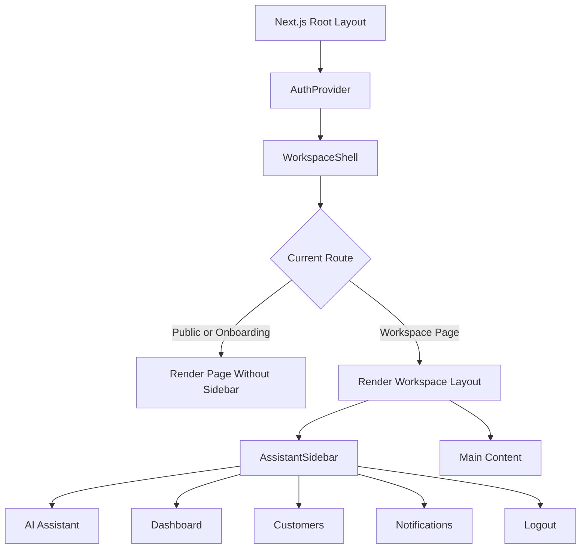

## 1. Root Application Layout

File: `frontend/src/app/layout.tsx`

The root layout is responsible for defining the application's global structure.

It includes:

- Global CSS.
- Application metadata.
- Authentication provider.
- Suspense boundary.
- Shared workspace shell.

The `AuthProvider` wraps the application so that authentication information can be accessed by child components using the `useAuth()` hook.

The `WorkspaceShell` wraps the page content and determines whether the shared navigation should be displayed.

## 2. Authentication Context

File: `frontend/src/features/auth/auth-context.tsx`

The project uses React Context API to manage authentication state globally.

The context maintains:

| State | Purpose |
|---|---|
| `user` | Authenticated user information |
| `token` | Authentication token |
| `isLoading` | Initial authentication loading state |
| `isAuthenticated` | Indicates whether a valid user and token are available |

### Authentication Initialization

When the application loads:

1. The provider retrieves the saved token using `getToken()`.
2. If no token exists, authentication loading finishes.
3. If a token exists, the provider calls `getCurrentUser()`.
4. If the request succeeds, user and token states are initialized.
5. If validation fails, the saved token is removed.
6. Authentication loading is completed.

The context also exposes two important methods:

- `setAuth()`: Saves the token and updates the authenticated user.
- `logout()`: Removes the token and clears authentication state.

### Custom Authentication Hook

Components access authentication through:

```typescript
const {
  user,
  token,
  isLoading,
  isAuthenticated,
  logout
} = useAuth();
```

This avoids passing authentication information manually through multiple component levels.

## 3. Workspace Shell

File: `frontend/src/features/layout/components/workspace-shell.tsx`

The `WorkspaceShell` component determines which pages should display the application sidebar.

The following routes are treated as public or onboarding pages:

- `/`
- `/login`
- `/register`
- `/onboarding/*`

These pages render without the workspace sidebar.

All other routes render inside the shared workspace layout.

### Responsive Sidebar

The component maintains a `mobileOpen` state.

On smaller screens:

- The sidebar remains hidden initially.
- A navigation button appears in the top header.
- Clicking the button opens the sidebar.
- An overlay allows the user to close it.
- Navigation actions close the sidebar.

On larger screens, the sidebar remains visible as the primary navigation.

## 4. Assistant Sidebar

File: `frontend/src/features/assistant/components/assistant-sidebar.tsx`

The sidebar provides navigation to:

| Navigation Item | Route |
|---|---|
| AI Assistant | `/assistant` |
| Dashboard | `/dashboard` |
| Customers | `/customers` |
| Notifications | `/notifications` |

It also provides two quick actions:

- New Chat
- Create Customer

The sidebar displays the authenticated user's name and provides a logout action.

The active navigation item is determined using Next.js `usePathname()`.

When the user logs out, the authentication context is cleared and the application redirects to `/login`.

## 5. Route-Level Authentication

Authentication checks are also implemented inside individual protected pages.

Examples include:

- `frontend/src/app/assistant/page.tsx`
- `frontend/src/app/customers/create/page.tsx`
- `frontend/src/app/customers/[customerId]/page.tsx`
- `frontend/src/app/notifications/page.tsx`

These pages check authentication state and redirect unauthenticated users to the login page.

The shared layout provides navigation structure, while individual pages handle their own authentication-dependent data loading.

## Key Learning

This module demonstrates React Context API, global authentication state, reusable layouts, responsive navigation, Next.js App Router, route-aware rendering, and client-side authentication checks.

---

# 18. AI Assistant – Voice and Text Transactions

## Overview

The AI Assistant is one of the central features of Universal Digital Khata.

It allows shop owners to record customer credit and payment transactions using natural language instead of manually filling out transaction forms.

Users can interact with the assistant through:

1. Text instructions.
2. Voice recordings.

The assistant extracts transaction information, identifies the customer, prepares a preview, and asks the shop owner to confirm the transaction before saving it.

It also integrates customer creation and credit risk information into the conversation workflow.

## Example Interaction

A shop owner can type or speak:

"Rahul ko 500 rupaye ka udhar diya."

The assistant processes the instruction and prepares a transaction containing:

- Customer: Rahul
- Transaction Type: Credit
- Amount: ₹500
- Description: Extracted from the instruction when available

The shop owner reviews the extracted information and confirms the transaction.

## High-Level Architecture

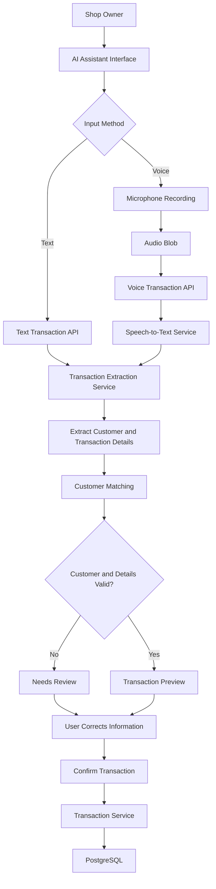

## 1. Assistant Page

File: `frontend/src/app/assistant/page.tsx`

This page contains the main conversational interface.

It manages several important application states:

- Chat messages.
- User text input.
- Customer list.
- Transaction drafts.
- Selected customers.
- Newly created customers.
- Transaction confirmation states.
- Saved transaction results.
- Customer credit risk information.
- Voice recording state.
- Voice processing state.
- Cancelled messages.
- High-risk customer warnings.

The page uses React state to maintain independent transaction information for different assistant messages.

Each message receives a unique UUID so that its associated transaction draft, customer selection, and confirmation state can be tracked separately.

## 2. Text-Based Transaction Entry

The assistant accepts natural-language instructions through a text input.

The main function is:

`handleSubmit()`

Its workflow:

1. Reads the user's message.
2. Removes unnecessary whitespace.
3. Adds the message to the conversation.
4. Calls `prepareTextTransaction()`.
5. Receives extracted transaction information.
6. Checks the customer matching result.
7. Loads customer credit risk information when a customer is uniquely matched.
8. Creates an assistant response with the extracted transaction preview.
9. Displays missing information when manual review is required.

The frontend does not directly save the extracted transaction at this stage.

## 3. Voice-Based Interaction

The assistant uses browser microphone APIs to capture audio.

Important browser APIs:

- `navigator.mediaDevices.getUserMedia()`
- `MediaRecorder`
- `Blob`

The recording workflow:

1. Requests microphone permission.
2. Starts audio recording.
3. Collects audio chunks.
4. Stops recording when requested.
5. Combines chunks into an audio Blob.
6. Sends the recording to the backend.
7. Receives the transcription and extracted transaction details.
8. Displays the result in the conversation.

The implementation also stops active media tracks when recording finishes or when the component is cleaned up.

## 4. Voice API Integration

File: `frontend/src/features/voice/voice-api.ts`

The frontend exposes the following functions:

| Function | Purpose |
|---|---|
| `transcribeVoice()` | Converts recorded audio into text |
| `prepareVoiceTransaction()` | Prepares a transaction from audio |
| `prepareTextTransaction()` | Prepares a transaction from natural-language text |
| `confirmVoiceTransaction()` | Confirms and saves a voice transaction |

The helper `createAudioFile()` converts the recorded Blob into a File with an appropriate audio extension.

The API client sends audio using `FormData`.

## 5. Transaction Preview

The assistant receives one of two main response states:

| Status | Meaning |
|---|---|
| `preview_ready` | Required information is available and a unique customer is matched |
| `needs_review` | Some information is missing or customer matching is ambiguous |

The preview displays:

- Transcribed text.
- Customer name.
- Transaction type.
- Amount.
- Due date.
- Description.
- Customer matching information.
- Missing fields.

The user can review the information before saving.

## 6. Customer Selection and Creation

If a customer cannot be found, the assistant can open a customer creation form.

The newly created customer is added to the assistant's local customer list and associated with the corresponding conversation message.

The shop owner can then select the new customer for the transaction.

This creates a connected workflow between natural-language transaction entry and customer management.

## 7. Credit Risk Integration

The assistant also integrates the credit risk API.

When a customer is uniquely matched, the frontend can load the customer's credit risk assessment.

The assistant maintains separate loading, error, and assessment states for customer risk information.

It also includes high-risk warning state management in the transaction confirmation workflow.

This helps the shop owner review customer repayment information while recording a new credit transaction.

## 8. Transaction Confirmation

Before saving, the assistant validates the selected customer and required transaction information.

It also validates:

- Customer selection.
- Transaction type.
- Positive transaction amount.
- Required fields.
- Due date restrictions.

For payment transactions, a due date is not allowed.

The assistant generates a confirmation UUID and reuses the same ID when retrying the confirmation request.

After successful confirmation, the transaction result is stored in the conversation state.

The backend performs the final validation and database insertion through the shared transaction service.

## Important Files

| File | Responsibility |
|---|---|
| `frontend/src/app/assistant/page.tsx` | Main conversational assistant |
| `frontend/src/features/voice/voice-api.ts` | Voice and text API integration |
| `frontend/src/features/voice/types.ts` | Voice request and response types |
| `frontend/src/features/voice/components/voice-recorder.tsx` | Microphone recording component |
| `frontend/src/features/voice/components/voice-transaction-assistant.tsx` | Voice preview and confirmation |
| `backend/app/api/voice.py` | Voice and text transaction endpoints |
| `backend/app/services/speech_to_text.py` | Audio transcription |
| `backend/app/services/voice_extraction.py` | Transaction extraction |
| `backend/app/services/customer_matching.py` | Customer identification |
| `backend/app/services/transaction.py` | Transaction creation |

## Key Learning

This module demonstrates conversational UI development, browser audio recording, MediaRecorder API, Blob and FormData handling, LLM-powered information extraction, asynchronous API integration, React state management, human-in-the-loop confirmation, and idempotent transaction processing.

---

# 19. Customer Creation & Form Improvements

## Overview

The Customer Creation module provides a dedicated workflow for adding new customers to a shop's digital ledger.

Every customer record contains essential identification and contact information.

The same reusable customer form is also integrated into the AI Assistant workflow, allowing shop owners to create a customer without leaving the conversation.

## Architecture

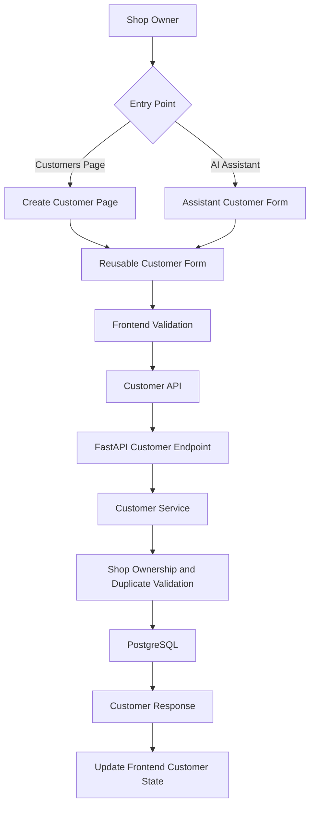

## 1. Reusable Customer Form

File: `frontend/src/features/customers/components/customer-form.tsx`

The `CustomerForm` component is designed to support customer creation from different parts of the application.

It accepts the following props:

| Prop | Purpose |
|---|---|
| `onCreated` | Callback after successful customer creation |
| `onCancel` | Optional cancellation callback |
| `initialFullName` | Optional initial customer name |

The optional `initialFullName` prop is particularly useful when the AI Assistant has already extracted a customer name from the user's instruction.

## 2. Customer Information Fields

The form collects:

- Customer full name.
- Mobile number.
- Address.
- Additional notes.

The first three fields are mandatory, while additional notes are optional.

## 3. Frontend Validation

Before calling the backend, the component performs input validation.

### Full Name

- Removes leading and trailing whitespace.
- Requires at least two characters.

### Mobile Number

The form accepts a 10-digit Indian mobile number.

The validation pattern is:

```typescript
/^[6-9]\d{9}$/
```

The input also removes non-numeric characters and limits the value to 10 digits.

### Address

The address must contain at least five characters.

### Additional Notes

Additional notes are optional and are trimmed before submission.

## 4. Customer API Integration

File: `frontend/src/features/customers/customer-api.ts`

The form calls the reusable `createCustomer()` API function.

The API sends the customer information to the backend using the authenticated API client.

## 5. Dedicated Customer Creation Page

File: `frontend/src/app/customers/create/page.tsx`

This page provides a dedicated customer creation screen.

Its responsibilities include:

1. Checking authentication state.
2. Redirecting unauthenticated users to login.
3. Displaying the customer creation form.
4. Handling successful creation.
5. Returning the user to the Customers page.
6. Supporting cancellation.

The page reuses the same `CustomerForm` component rather than duplicating its validation and submission logic.

## 6. Integration with AI Assistant

File: `frontend/src/app/assistant/page.tsx`

When the assistant cannot find a customer but has extracted a customer name, it can open the customer creation workflow.

The assistant maintains the following states:

- `creatingCustomerFor`
- `createdCustomers`
- `selectedCustomers`

After successful creation:

1. The new customer is added to the local customer list.
2. The customer is associated with the relevant assistant message.
3. The newly created customer is selected for that transaction.
4. The user can continue reviewing and confirming the transaction.

This reduces the need to navigate away from the assistant to create a missing customer.

## 7. Customer Details Integration

File: `frontend/src/app/customers/[customerId]/page.tsx`

The customer details page combines several customer-related features:

- Customer profile information.
- Outstanding balance.
- Credit risk assessment.
- Manual transaction form.
- Voice transaction assistant.
- Transaction history.

After a successful transaction, the page reloads customer information and triggers a fresh credit risk assessment.

This connects customer creation and management with the transaction lifecycle.

## Backend Validation

The backend customer module provides the final validation and persistence layer.

Important files:

- `backend/app/api/customer.py`
- `backend/app/services/customer.py`
- `backend/app/schemas/customer.py`
- `backend/app/models/customer.py`

The backend validates customer ownership through the shop relationship and prevents duplicate mobile numbers within the same shop.

The database also enforces a unique constraint on the combination of shop ID and mobile number.

## Key Learning

This module demonstrates reusable React forms, controlled inputs, client-side validation, authenticated API integration, component reuse, callback-based state updates, and integration between customer management and AI-assisted transaction workflows.

---

# 20. Offline Transaction Storage & Synchronization

## Overview

Small shops may experience unstable internet connectivity, especially when transactions need to be recorded quickly.

The Offline Transaction module introduces local transaction storage using IndexedDB.

Instead of requiring an immediate backend connection for every transaction, the application can save transaction data in the browser and maintain it in an offline queue.

When synchronization is requested and authentication is available, queued transactions can be submitted to the backend.

This provides the foundation for offline-first transaction recording.

## Architecture

```mermaid
flowchart TD
    A[Transaction Input] --> B[Validate Required Fields]
    B --> C[Generate Local UUID]
    C --> D[Generate Idempotency Key]
    D --> E[Save to IndexedDB]
    E --> F[Pending Offline Queue]
    F --> G[User Requests Sync]
    G --> H[Check Authentication Token]
    H --> I[Load Pending and Failed Records]
    I --> J[Mark Record as Syncing]
    J --> K[POST Transaction API]
    K --> L{Backend Response}
    L -->|Success| M[Mark as Synced]
    L -->|Failure| N[Mark as Failed]
    N --> O[Increment Retry Count and Store Error]
```

## 1. IndexedDB Database Design

File: `frontend/src/lib/offline-db.ts`

The project uses the `idb` library to provide a Promise-based interface for IndexedDB.

The database schema defines:

- Database type: `KhataDB`
- Offline record type: `OfflineTransaction`
- Synchronization status type: `SyncStatus`

The supported synchronization states are:

| Status | Meaning |
|---|---|
| `pending` | Waiting for synchronization |
| `syncing` | Currently being submitted |
| `synced` | Successfully submitted to the backend |
| `failed` | Synchronization failed |

Each offline transaction stores:

| Field | Purpose |
|---|---|
| `id` | Local transaction UUID |
| `idempotencyKey` | Backend duplicate-prevention key |
| `data` | Original transaction payload |
| `syncStatus` | Current synchronization status |
| `retryCount` | Number of failed synchronization attempts |
| `createdAt` | Local creation timestamp |
| `lastError` | Most recent synchronization error |

The schema also defines indexes for synchronization status and creation time.

## 2. Offline Database Initialization

File: `frontend/src/lib/offline-storage.ts`

The database is initialized through:

`getOfflineDB()`

The database configuration is:

- Database name: `universal-digital-khata`
- Database version: `1`
- Object store: `offlineTransactions`
- Primary key: `id`

The implementation uses `openDB()` from the `idb` package.

It also checks whether the code is executing in the browser because IndexedDB is not available during server-side rendering.

A cached database promise avoids repeatedly opening the same database connection.

## 3. Offline Transaction Queue

File: `frontend/src/lib/offline-queue.ts`

The main function is:

`queueOfflineTransaction()`

It accepts a normal `TransactionCreate` payload.

It then generates:

- A local transaction UUID.
- A unique idempotency key.
- A pending synchronization status.
- An initial retry count of zero.
- A creation timestamp.

The complete transaction is saved locally using `saveOfflineTransaction()`.

The function returns the newly created offline transaction.

## 4. Offline Repository Layer

File: `frontend/src/lib/offline-repository.ts`

This module provides reusable functions for interacting with the local IndexedDB object store.

### Available Functions

| Function | Responsibility |
|---|---|
| `saveOfflineTransaction()` | Save a transaction locally |
| `getOfflineTransaction()` | Retrieve a transaction using its local ID |
| `getPendingOfflineTransactions()` | Retrieve pending transactions |
| `getUnsyncedOfflineTransactions()` | Retrieve pending and failed transactions |
| `updateOfflineTransaction()` | Update transaction status and metadata |
| `deleteOfflineTransaction()` | Delete a local transaction |

The repository sorts queued transactions by their creation timestamp.

This allows the synchronization process to handle older transactions first.

## 5. Offline Synchronization Service

File: `frontend/src/lib/offline-sync.ts`

The main synchronization function is:

`syncOfflineTransactions()`

It accepts the authentication token and returns an `OfflineSyncResult`.

The result contains:

- Number of successfully synchronized transactions.
- Number of failed transactions.
- Successfully returned transaction responses.

### Synchronization Workflow

1. Check that an authentication token is available.
2. Retrieve pending and failed local transactions.
3. Process transactions sequentially.
4. Mark the current transaction as `syncing`.
5. Submit it using the normal transaction API.
6. Pass the stored idempotency key in the request header.
7. Mark successful